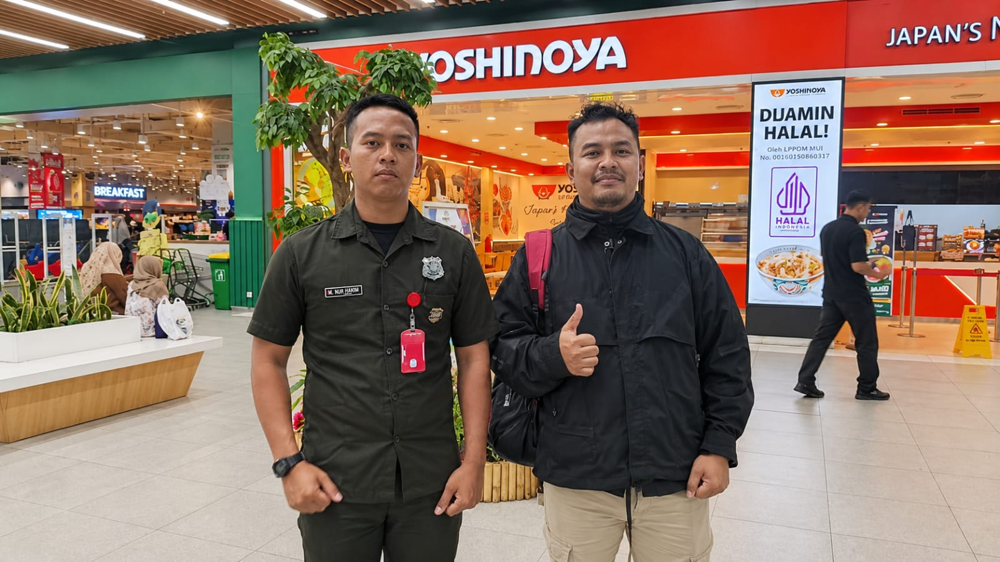
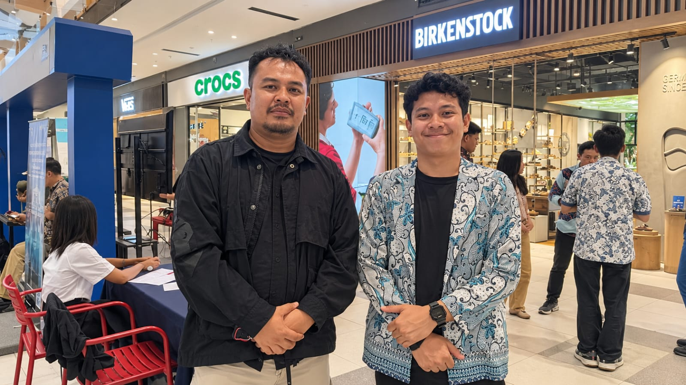
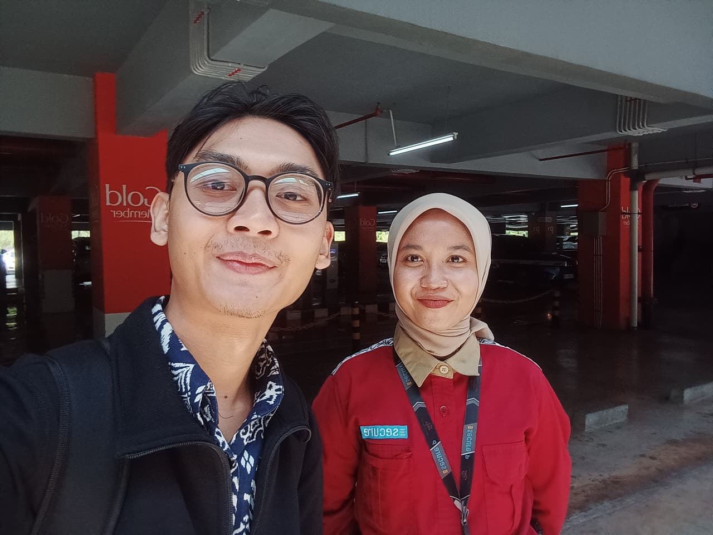
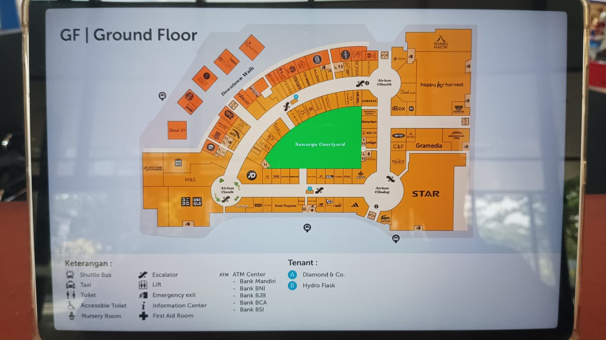
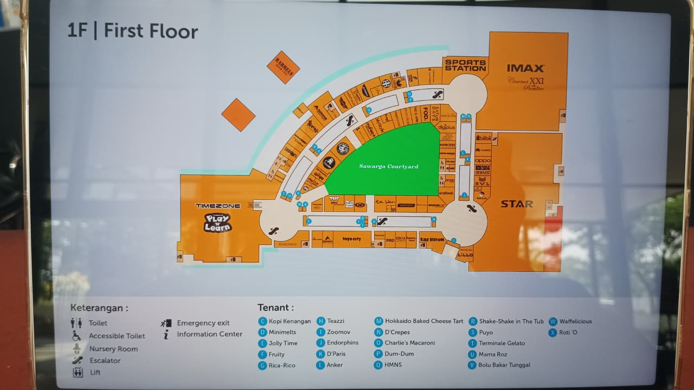
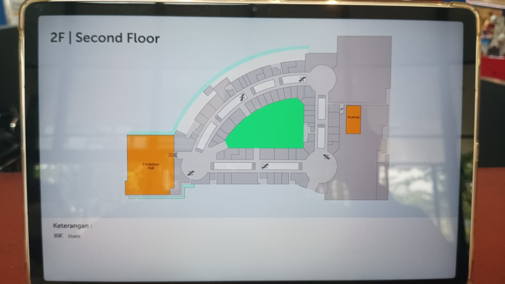

# Dokumentasi Riset Lapangan

Semua wawancara dilakukan **tatap muka** di Summarecon Mall Bandung, Kamis 12 November 2026.

## Foto wawancara

| | Narasumber | Waktu |
|---|---|---|
|  | **Pak Asep**, Security | 09.00–09.30 |
|  | **Pak Ade**, Manajemen Mall (PIC Event) | 09.50–10.30 |
|  | **Bu Mei**, Petugas Parkir | 11.00–11.30 |

## Denah mall

Difoto dari papan informasi di dalam mall.

### Ground Floor
Atrium Cibadag (sisi timur), Atrium Ciunik (sisi barat), Sawarga Courtyard (tengah).

### First Floor

### Second Floor

## Masih bisa ditambahkan

| File | Isi |
|---|---|
| `foto_papan-tarif-parkir.jpeg` | Papan tarif parkir di gate |
| `foto_gate-parkir-motor.jpeg` | Kondisi gate/antrean parkir motor |
| `screenshot_gmaps_jam-sibuk.png` | "Jam sibuk" Google Maps Summarecon Mall Bandung |
