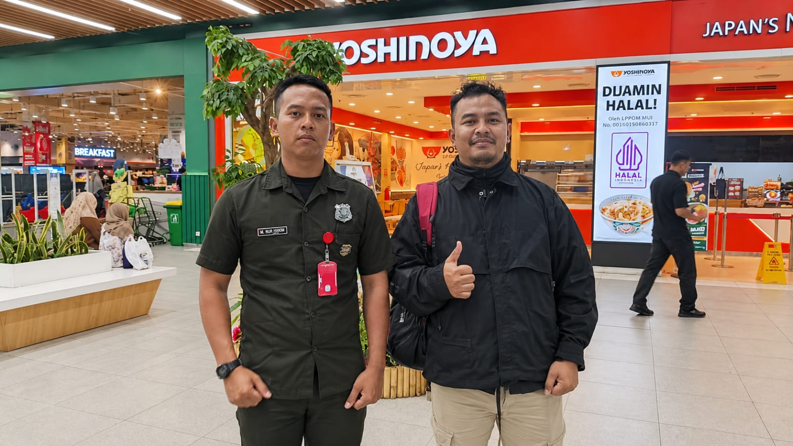

# Wawancara 1: Pak Asep (Security)

| | |
|---|---|
| **Narasumber** | Pak Asep, Security Summarecon Mall Bandung |
| **Waktu** | Kamis, 12 November 2026, 09.00–09.30 WIB |
| **Lokasi** | Summarecon Mall Bandung (tatap muka) |
| **Topik** | Penjagaan keramaian saat event, parkir, gate, gelang peserta |
| **Dokumentasi** | [Foto wawancara](../dokumentasi/foto-01_pak-asep_security_2026-11-12.jpeg) |



## Catatan saat wawancara

Ditulis apa adanya saat wawancara berlangsung.

```
penempukan org banyak
cctv doang
pekerja mobile 3 shift 2 orang lt 1
shift 2 orang
shift 3
6 orang
cibadag atrium
trouble diluar di parkir
gate ga ditutup masuk terus
gate parking
sekarang pake gelang
area luas parkir
solusi saat ini nya penuh di gate cut
area kawasan bahu jalan di lempar
kapasitas parkir penampungan parkir
```

## Poin penting

| Topik | Temuan |
|---|---|
| Pemantauan keramaian | Penumpukan orang saat event hanya dipantau lewat **CCTV** |
| Petugas | Petugas mobile lantai 1: **2 orang per shift × 3 shift = 6 orang** per hari |
| Titik ramai | **Atrium Cibadag** (Ground Floor) |
| Parkir | Masalah sering terjadi **di luar, di parkir**. Gate tidak ditutup tepat waktu, kendaraan masuk terus |
| Penanganan sekarang | Kalau penuh, **gate ditutup (cut)** dan kendaraan **dialihkan ke bahu jalan** |
| Gelang | Peserta event memakai **gelang** untuk membedakan dengan pengunjung mall |

## Kutipan (parafrase dari catatan)

> "Kalau ada event, penumpukan orang kami pantau dari CCTV saja. Petugas mobile di lantai 1 cuma 2 orang per shift."

> "Masalahnya sering di luar, di parkir. Gate tidak ditutup, jadi kendaraan masuk terus. Kalau sudah penuh baru gate di-cut, sisanya dilempar ke bahu jalan."

> "Sekarang pakai gelang untuk membedakan mana peserta event, mana pengunjung mall."
