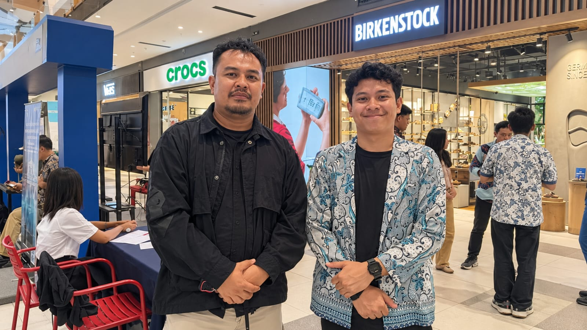

# Wawancara 2: Pak Ade (Manajemen Mall, PIC Event)

| | |
|---|---|
| **Narasumber** | Pak Ade, Manajemen Summarecon Mall Bandung, PIC Event |
| **Waktu** | Kamis, 12 November 2026, 09.50–10.30 WIB |
| **Lokasi** | Summarecon Mall Bandung (tatap muka) |
| **Topik** | Event, ticketing, komplain pengunjung, approval event |
| **Dokumentasi** | [Foto wawancara](../dokumentasi/foto-02_pak-ade_manajemen-pic-event_2026-11-12.jpeg) |



## Catatan saat wawancara

Ditulis apa adanya saat wawancara berlangsung.

```
bahas komplenan koreksi dari customer ada tim ke manajemen
toilet banyak masuk
lapor di medsos toilet nya bau nih
sentimen negatif
udh ada sop
eventnya bukan hanya buat summarecon
tapi buat tenant tenant juga
setiap hari bikin event
internal dan eksternal
setiap event ticketing blm ada sistemnya
bisa kepantau
inginnya masuknya ke sistem

approval ada 2 pengaju event, event management sama mall operasional
ada tampilan terkait approval
divisi event
divisi operational mall
persyaratan event upload dokumennya apa aja, surat keramaian dll
pain point event birokrasi approval lama
pain point mall parkirnya
kalo itu ga diatasi dampak kerugiannya sekian
```

Klarifikasi: untuk event bertiket, manajemen saat ini memakai **loket.com**. Summarecon belum punya sistem ticketing sendiri.

## Poin penting

| Topik | Temuan |
|---|---|
| Frekuensi event | **Hampir setiap hari**, internal dan eksternal |
| Penyelenggara | Bukan hanya Summarecon, **juga tenant**. Atrium disewakan |
| Ticketing | Memakai **loket.com**, belum ada sistem sendiri |
| Keinginan manajemen | **Yang masuk tercatat di sistem dan bisa dipantau** |
| Komplain | Dibahas tim lalu dibawa ke manajemen. SOP sudah ada, tapi reaktif |
| Contoh komplain | Toilet penuh saat ramai → laporan medsos "toiletnya bau" → sentimen negatif |
| Approval event | Harus disetujui **2 divisi** (event dan operasional mall) + dokumen seperti **surat izin keramaian**. Prosesnya **lama** |
| Pain point | Event: birokrasi approval. Mall: parkir |

## Kutipan (parafrase dari catatan)

> "Hampir setiap hari ada event, internal maupun eksternal. Eventnya bukan cuma untuk Summarecon, tapi juga untuk tenant-tenant."

> "Untuk ticketing event kami masih pakai loket.com. Summarecon sendiri belum punya sistem ticketing."

> "Inginnya yang masuk itu tercatat di sistem, jadi bisa kepantau."

> "Kalau toilet penuh, pengunjung langsung lapor di medsos, 'toiletnya bau'. Jadinya sentimen negatif."

> "Pengajuan event harus lewat dua pihak, divisi event dan operasional mall. Dokumennya juga banyak, seperti surat izin keramaian. Approval-nya lama."
