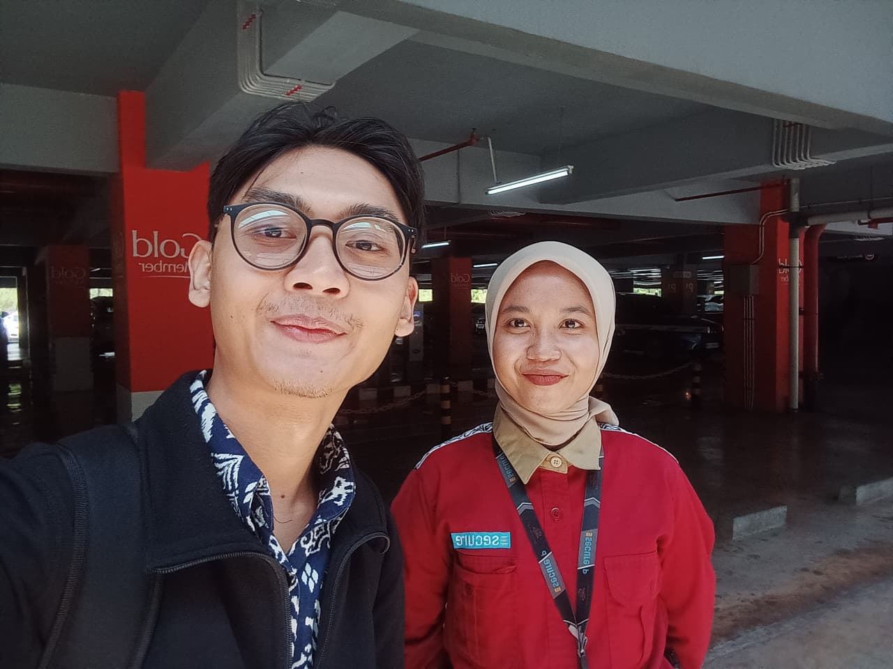

# Wawancara 3: Bu Mei (Petugas Parkir)

| | |
|---|---|
| **Narasumber** | Bu Mei, petugas parkir yang sedang berjaga |
| **Waktu** | Kamis, 12 November 2026, 11.00–11.30 WIB |
| **Lokasi** | Area parkir Summarecon Mall Bandung (tatap muka) |
| **Pewawancara** | Martio |
| **Topik** | Kapasitas parkir, alur masuk kendaraan, kendala di gate, event paling ramai |
| **Dokumentasi** | [Foto wawancara](../dokumentasi/foto-03_bu-mei_petugas-parkir_2026-11-12.jpeg) |



## Catatan saat wawancara

Ditulis apa adanya saat wawancara berlangsung.

```
event besar terakhir yg crowded banget:
  kemenkeu event
  festival kuliner bandung
sewa sewa atrium

area parkir:
  satu parkiran timur
  sama parkiran lobby selatan
  dibelakang parkiran caang yg dulu parkiran kulineran

kapasitas motor 1200
kapasitas mobil 2000 (semua)
800 satu parkiran
gold member ada parkir khusus
ada motor besar moge 4 lot

petugas parkir 5 orang pagi, 1 pengawas pagi mobile

plat ga kebaca masih manual ngetik
motor banyak yg ga ada platnya
intercom nanya plat user yg mau parkir
pengecekan stnk
kalo rame bgt ga ke handle
1.2 udh tutup di motor
kalo ada parkir kosong langsung buka gatenya
```

Klarifikasi:
- "plat ga kebaca, manual ngetik" = umumnya **motor yang tidak ada platnya**.
- "1.2 udh tutup di motor" = parkir motor sudah **penuh di angka 1.200** (kapasitas maksimal) dan ditutup saat wawancara.

## Poin penting

| Topik | Temuan |
|---|---|
| Area parkir | Parkiran Timur, Parkiran Lobby Selatan, parkiran belakang (dulu area kuliner) |
| Kapasitas | **Mobil ±2.000** (semua area), **motor maksimal 1.200**, **±800 per area** |
| Lot khusus | 4 lot moge, parkir khusus gold member |
| Petugas | Shift pagi: **5 petugas + 1 pengawas mobile** |
| Kondisi saat wawancara | **Parkir motor penuh (1.200) dan ditutup**, hari Kamis sebelum pukul 11.30 |
| Gate | Motor tanpa plat → ditanya lewat **intercom**, cek **STNK**, plat **diketik manual** |
| Saat ramai | **Tidak tertangani** |
| Buka-tutup gate | Manual: begitu ada slot kosong, gate langsung dibuka lagi |
| Event paling ramai | Event Kemenkeu (Roeang Kita) dan Festival Kuliner Bandung |

## Kutipan (parafrase dari catatan)

> "Kapasitasnya mobil sekitar 2.000, motor maksimal 1.200. Satu parkiran kira-kira 800."

> "Motor banyak yang tidak ada platnya. Jadi kami tanya lewat intercom, cek STNK, terus platnya diketik manual."

> "Kalau lagi rame banget, tidak ke-handle."

> "Parkir motor sudah tutup, sudah 1.200. Kalau ada yang kosong, gatenya langsung kami buka lagi."

> "Event yang terakhir paling ramai itu event Kemenkeu sama Festival Kuliner Bandung."
