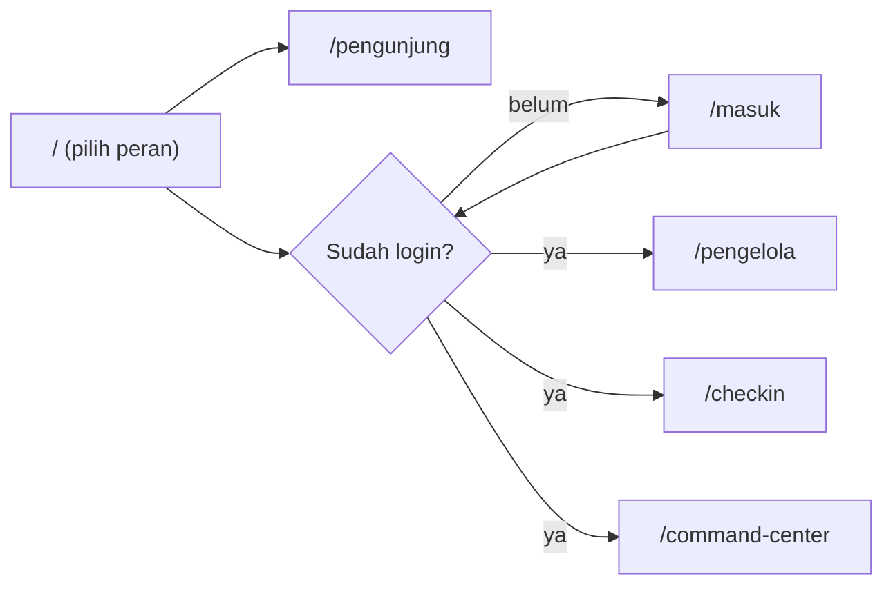
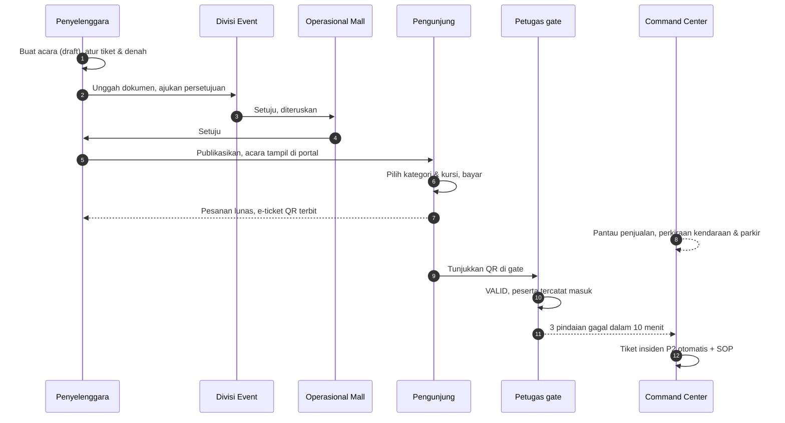
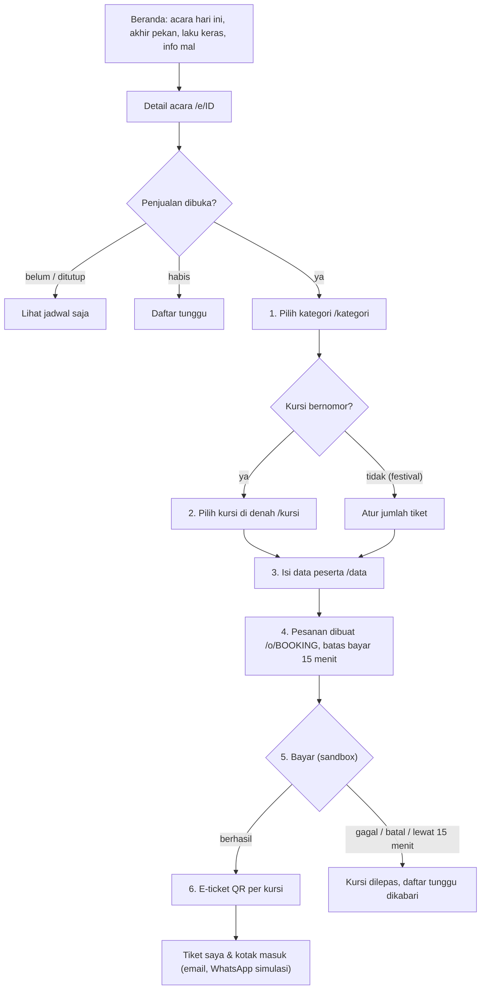
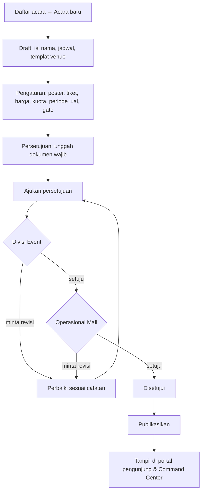
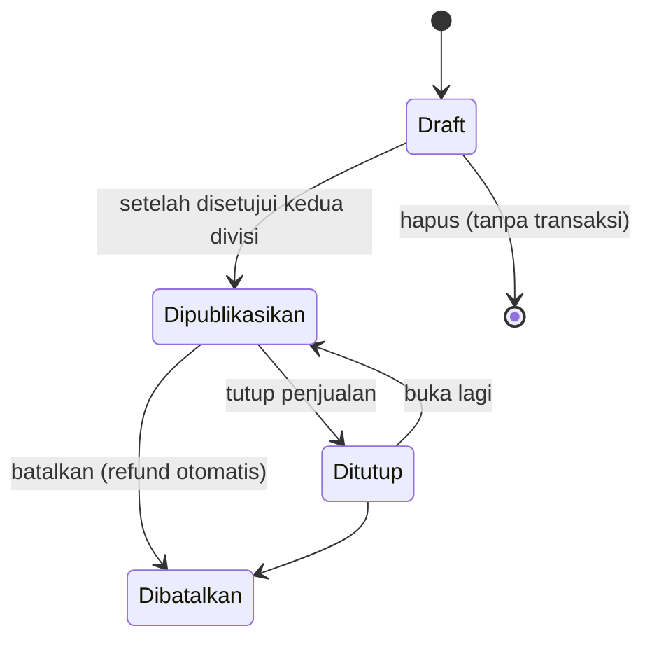
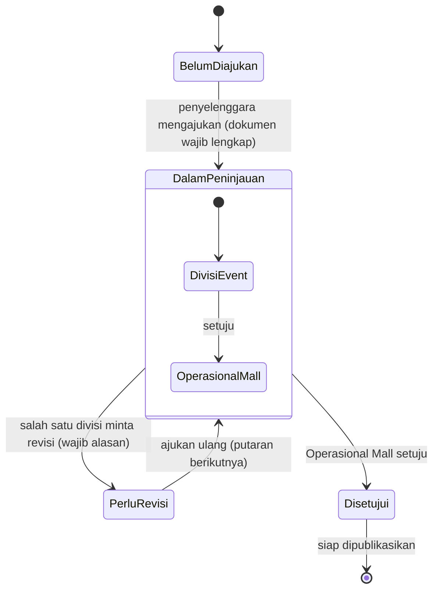
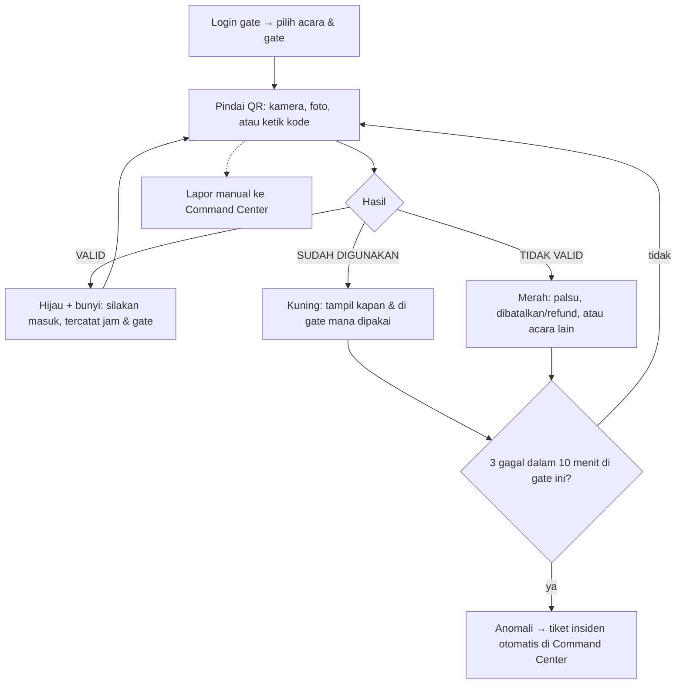
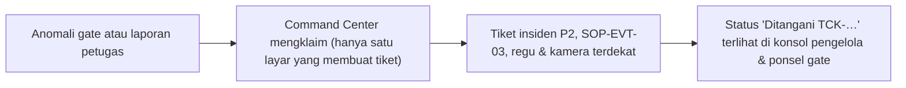
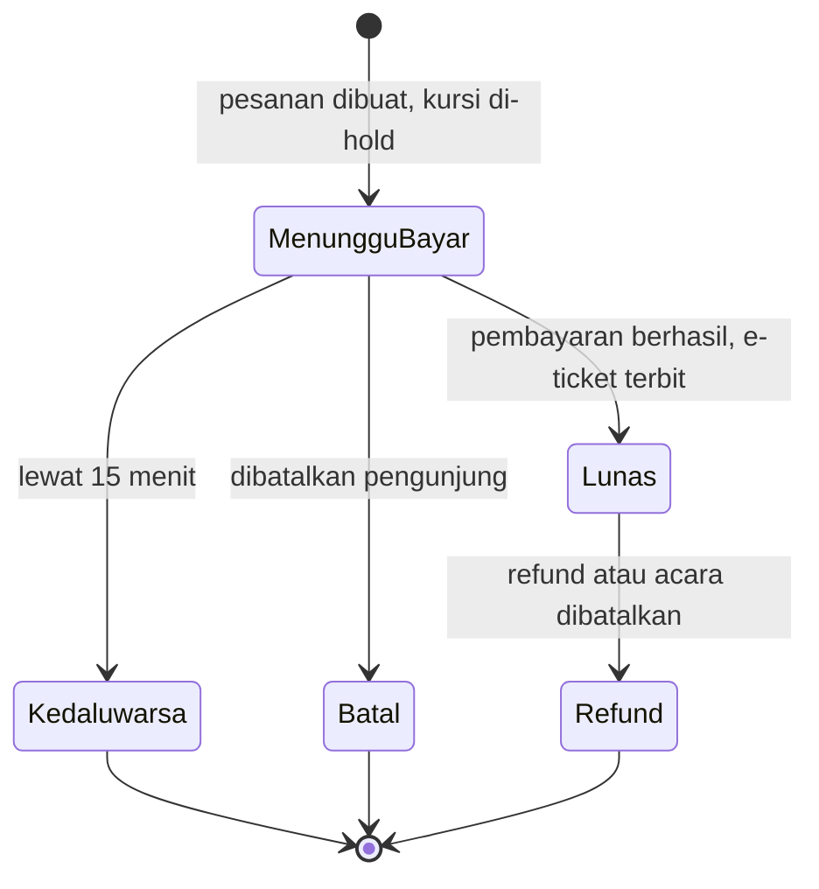

# User flow SMICC-TS

Alur pengguna pada prototype yang sudah berjalan di https://smiccts.vercel.app. Semua portal membaca data yang sama, jadi perubahan di satu portal langsung terlihat di portal lain.

## 1. Peran dan pintu masuk

| Peran | Portal | Login | Tujuan utama |
|---|---|---|---|
| Pengunjung | `/pengunjung` | Tidak wajib (akun demo untuk "Tiket saya") | Cari acara, beli tiket, simpan e-ticket QR |
| Penyelenggara acara (EO, tenant, tim event mall) | `/pengelola` | Akun staf `pengelola` | Buat acara, ajukan persetujuan, jual tiket, kelola peserta |
| Divisi Event & Operasional Mall | `/pengelola` → menu Persetujuan | Akun staf `pengelola` (simulasi peran) | Menyetujui atau meminta revisi pengajuan acara |
| Petugas gate | `/checkin` (ponsel) | Akun staf `gate` atau `pengelola` | Pindai QR peserta di pintu masuk |
| Manajemen mall / operator | `/command-center` | Akun staf `command-center` | Memantau semua acara, parkir, keramaian, dan insiden |

Halaman `/` menampilkan pilihan peran. Portal staf tanpa sesi diarahkan ke `/masuk`, lalu kembali ke halaman yang dituju setelah login.

## 2. Gambaran lintas peran

Satu acara melewati empat peran, dari pengajuan sampai hari H.

## 3. Pengunjung (`/pengunjung`, mobile-first)

| Langkah | Yang dilihat pengunjung | Aturan sistem |
|---|---|---|
| Pilih kategori | Harga dan sisa kuota per kategori | Kategori habis menawarkan daftar tunggu |
| Pilih kursi | Denah kategori terpilih, kursi lain samar | Kursi langsung dikunci **8 menit** untuk orang lain. Dua orang memilih kursi yang sama: hanya satu berhasil |
| Isi data | Nama, email, WhatsApp, nama pemegang per tiket (opsional) | Maks 4 tiket per pesanan (bisa diatur per acara) |
| Ringkasan & bayar | Total + biaya layanan Rp5.000/tiket, hitung mundur | Batas bayar **15 menit**. Callback pembayaran idempoten, e-ticket tidak terbit dua kali |
| E-ticket | QR per kursi, status check-in, simpan ke kalender | QR bertanda tangan, tidak bisa dipalsukan dengan mengetik ulang |

## 4. Penyelenggara acara (`/pengelola`)

### 4.1 Dari draft sampai dijual

Dokumen persyaratan: proposal & rundown, denah area & perkiraan jumlah pengunjung, surat izin keramaian (wajib), rencana keamanan & K3 (opsional).

### 4.2 Selama penjualan dan hari H

| Menu | Kegiatan |
|---|---|
| Ringkasan | Tiket terjual, pendapatan, kehadiran, blok **Perlu tindakan** (pesanan menunggu bayar, anomali gate, persetujuan tertunda) |
| Denah kursi | Lihat pemesan per kursi, blokir kursi (kamera, FOH, kursi roda) |
| Peserta & transaksi | Cari pesanan, ubah data peserta, kirim ulang e-ticket, refund, ekspor CSV |
| Check-in & gate | Pindai QR dari konsol, statistik per gate, lapor anomali ke Command Center |
| Kirim broadcast | Kirim pengingat massal, kabari daftar tunggu |
| Keuangan & ROI | Rekonsiliasi per metode bayar, selisih, ROI untuk mall |
| Persetujuan | Status approval, dokumen, dan **log aktivitas** acara |

Aksi berisiko (tutup penjualan, batalkan acara, hapus, refund) selalu lewat dialog konfirmasi. **Batalkan acara** me-refund semua pesanan lunas dan mengabari peserta.

### 4.3 Status acara

## 5. Divisi Event dan Operasional Mall (menu Persetujuan)

- Operasional Mall baru bisa memutuskan setelah Divisi Event setuju.
- Dokumen terkunci selama ditinjau dan setelah disetujui.
- Layar menampilkan lama tiap divisi meninjau dan total waktu sejak pengajuan pertama. Pengajuan yang menunggu lebih dari 2 hari ditandai di **Perlu tindakan**.
- **Log aktivitas** mencatat siapa, peran, kapan, aksi, dan catatan untuk setiap langkah dan perubahan acara (dokumen, pengajuan, keputusan, publikasi, perubahan harga atau jadwal, refund, pembatalan). Log hanya bisa ditambah dan bisa diunduh CSV. Tanda "Log utuh" berubah merah bila ada entri yang diubah.
- Prototype: satu akun pengelola bertindak sebagai kedua divisi (ditandai "Simulasi"). Dokumen hanya dicatat nama dan ukurannya.

Contoh di data demo: **EVT-28 Expo UMKM Gedebage Berdaya**, sudah disetujui Divisi Event, menunggu Operasional Mall.

## 6. Petugas gate (`/checkin`)

Dua gate memindai QR yang sama bersamaan: hanya satu yang VALID, yang lain SUDAH DIGUNAKAN.

## 7. Command Center (`/command-center`)

| Kelompok | Menu | Dipakai untuk |
|---|---|---|
| Operasional | Tiket & Insiden | Antrean insiden, prioritas P1 sampai P4, SLA, penugasan regu |
| | Fasilitas & BMS | Status perangkat gedung (HVAC, listrik, kebocoran) |
| | Layanan Tenant & SLA | Permintaan tenant dan pemenuhan SLA |
| | CCTV & Keamanan | Peringatan kamera |
| | Energi & Utilitas | Pemakaian energi |
| | Parkir & Mobilitas | Okupansi parkir mobil dan motor |
| | Pemantauan Event | Portofolio semua acara (hanya baca), dampak ke parkir dan keramaian, keamanan gate |
| Eksekutif | Analitik & Laporan, Komersial & Keuangan, Analisis Sentimen | Ringkasan untuk manajemen; sentimen ulasan publik dan rekomendasi pengembangan mall & event |
| SOP & Simulasi | Pusat SOP & Runbook, Simulator Use Case | SOP per kejadian dan simulasi langkah demi langkah |

Alur insiden dari event:

## 8. Status pesanan dan tiket

| E-ticket | Arti |
|---|---|
| Aktif, belum check-in | Bisa dipakai masuk |
| Aktif, sudah check-in | Pindai ulang = SUDAH DIGUNAKAN |
| Void | Pesanan di-refund atau acara dibatalkan, pindaian = TIDAK VALID |

## 9. Batasan prototype

- Pembayaran, email, dan WhatsApp adalah simulasi (sandbox dan kotak keluar).
- Login pengunjung adalah akun demo di browser, bukan akun sungguhan.
- Persetujuan memakai satu akun pengelola untuk semua divisi.
- Data tiket insiden Command Center tersimpan per browser.
