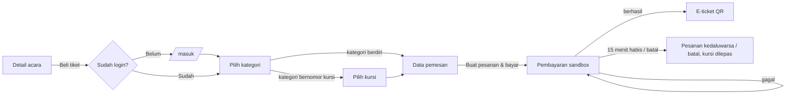
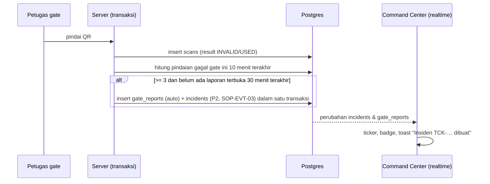
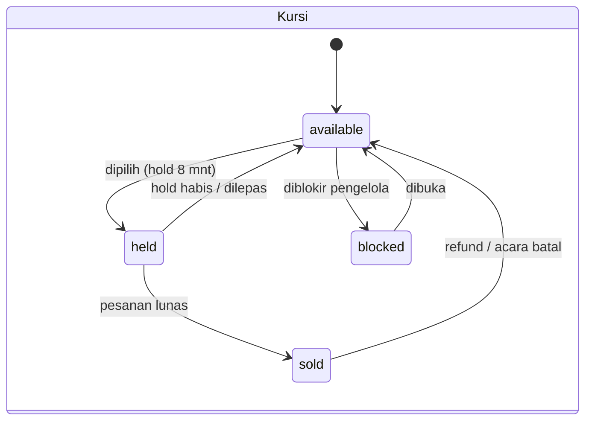
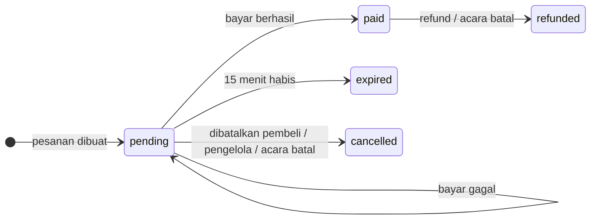
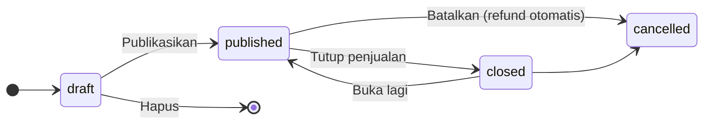
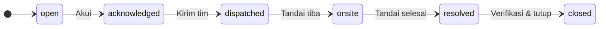
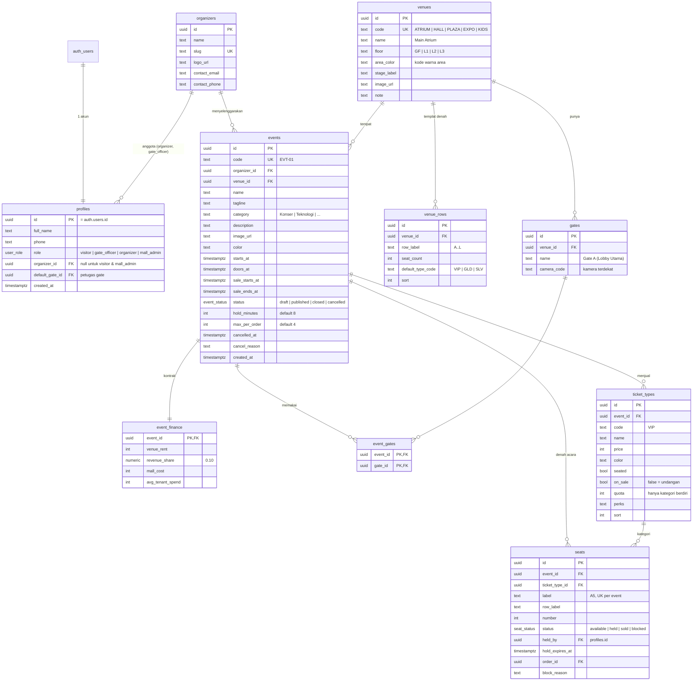
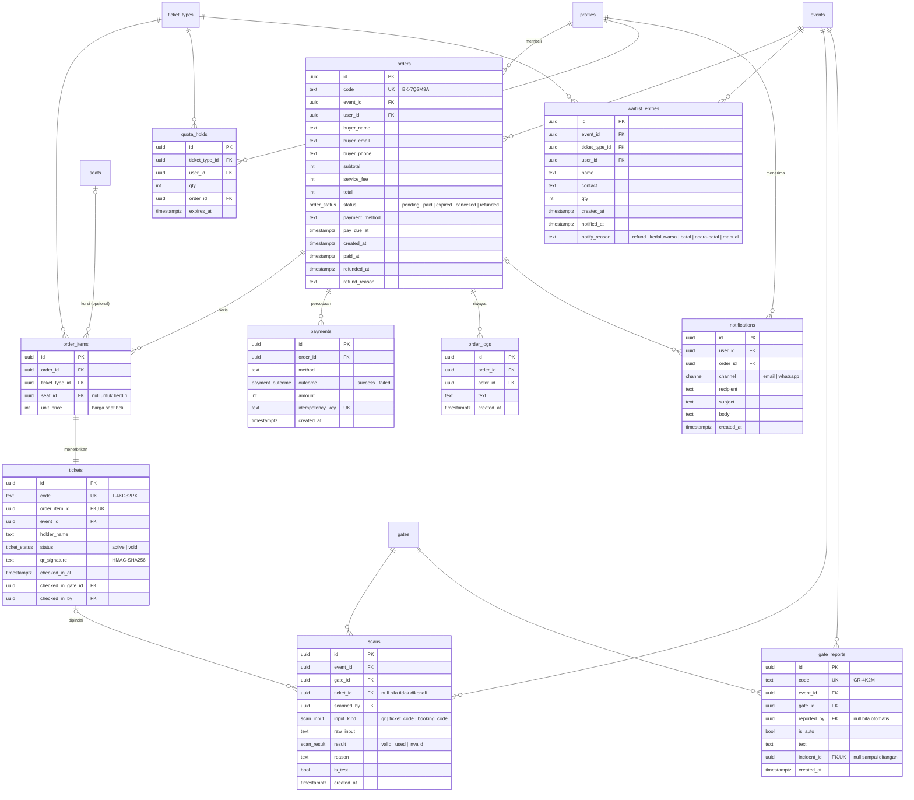
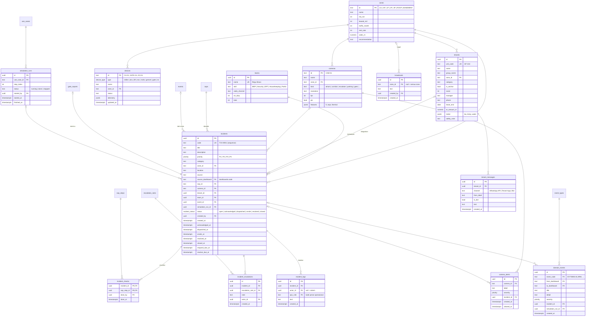
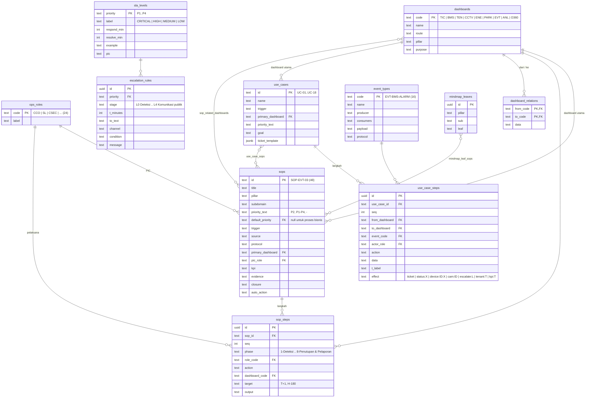

# PRD: SMICC-TS versi baru

Summarecon Mall Integrated Command Center Ticketing System: event & tiket Summarecon Mall Bandung.

| | |
|---|---|
| Status | Draf v2, menunggu persetujuan |
| Tanggal | 2026-11-10 |
| Sumber | Kode versi lama (`app/js/event/*`, `app/js/command-center/*`, `server/*`, `tools/docs/*.py`), `docs/fitur.md`, `docs/EVENT_TICKETING_Asumsi_Alur_Logika.md`, `docs/PANDUAN_Teks_UI.md` |
| Panduan visual | [DESIGN.md](DESIGN.md) |

Dokumen ini ikut pindah ke repo baru begitu repo itu dibuat.

---

## 1. Ringkasan

Satu sistem untuk seluruh siklus acara di dalam mal. Pengunjung menemukan dan membeli tiket. Penyelenggara
membuat dan menjual acaranya. Petugas gate memindai e-ticket. Manajemen mal melihat dampaknya ke
parkir, keamanan, fasilitas, dan pendapatan, lalu menangani insiden sesuai SOP.

Yang membedakan dari platform tiket umum (Artatix, LOKET, GOERS): **tiket terhubung ke operasional
gedung**. Penjualan tiket menjadi proyeksi kendaraan, personel keamanan, dan pre-cooling AC. Pindaian
gagal di gate menjadi insiden P2 di Command Center lengkap dengan SOP, SLA, dan regu yang ditugaskan.

### 1.1 Tujuan demo (Demo Day 15 Nov 2026)

1. Juri membeli tiket dari ponselnya sendiri dan mendapat e-ticket QR dalam kurang dari 2 menit.
2. Kursi yang dipilih di satu ponsel langsung tampil "sedang dipesan" di layar lain, tanpa reload.
3. QR yang sama dipindai di dua gate bersamaan: satu VALID, satu SUDAH DIGUNAKAN.
4. Tiga pindaian gagal di satu gate langsung menjadi insiden P2 di Command Center, lengkap dengan
   checklist SOP-EVT-03 dan hitung mundur SLA.
5. Juri bisa masuk ke keempat portal dengan satu klik dari halaman login (akun demo).
6. Semua berjalan di paket gratis Vercel Hobby + Supabase Free.

### 1.2 Di luar lingkup

Pembayaran sungguhan, email/WhatsApp sungguhan (disimulasikan sebagai kotak masuk), aplikasi mobile
native, mode offline LAN, integrasi ke sistem internal Summarecon (BMS, CCTV, POS) yang sebenarnya.

---

## 2. Pengguna, peran, dan login

### 2.1 Empat portal

| Portal | Path | Peran (`role`) | Pengguna | Pekerjaan utama |
|---|---|---|---|---|
| Pengunjung | `/pengunjung` | `visitor` | Warga Bandung, keluarga, anak muda | Menemukan acara, membeli tiket, menunjukkan e-ticket |
| Petugas gate | `/checkin` | `gate_officer` | Staf pintu masuk dari penyelenggara | Memindai e-ticket, melapor kejadian di gate |
| Pengelola | `/pengelola` | `organizer` | Event organizer / panitia | Membuat, menjual, dan mengelola acaranya |
| Command Center | `/command-center` | `mall_admin` | Manajemen & operator mal | Memantau semua acara dan operasional mal, menangani insiden |

Halaman katalog pengunjung **terbuka tanpa login**. Login diminta saat membeli tiket, membuka Tiket
saya, atau masuk ke tiga portal lainnya.

### 2.2 Login email & password (menggantikan PIN)

Satu halaman `/masuk` untuk semua peran. Setelah login, pengguna diarahkan sesuai perannya:
`visitor` kembali ke halaman asal (mis. langkah beli), `gate_officer` ke `/checkin`, `organizer` ke
`/pengelola`, `mall_admin` ke `/command-center`.

```
┌──────────────────────────────────────────┐
│  [▣] Summarecon Mall Bandung             │
│                                          │
│  Masuk                                   │
│  Email      [                        ]   │
│  Password   [                     👁 ]   │
│  [            Masuk              ]       │
│  Belum punya akun? Daftar                │
│                                          │
│  ── Akun demo ──────────────────────     │
│  Klik untuk mengisi email & password.    │
│  ┌───────────────┐ ┌───────────────┐     │
│  │ 🎟 Pengunjung  │ │ ▣ Petugas gate │     │
│  │ pengunjung@…  │ │ gate@…        │     │
│  └───────────────┘ └───────────────┘     │
│  ┌───────────────┐ ┌───────────────┐     │
│  │ ⚙ Pengelola    │ │ ◎ Command Ctr  │     │
│  │ pengelola@…   │ │ cc@…          │     │
│  └───────────────┘ └───────────────┘     │
└──────────────────────────────────────────┘
```

| Aturan | Nilai |
|---|---|
| Penyedia | Supabase Auth (email + password), konfirmasi email dimatikan untuk demo |
| Akun demo | 4 kartu di bawah form. Klik kartu mengisi email dan password, fokus pindah ke tombol Masuk. Pengguna tetap menekan Masuk sendiri |
| Daftar | `/daftar`: nama, email, WhatsApp, password. Selalu menjadi `visitor`. Peran lain hanya dibuat oleh `mall_admin` atau lewat seed |
| Sesi | Cookie HttpOnly dari Supabase Auth, berlaku 12 jam, diperbarui otomatis |
| Gagal login | Pesan "Email atau password salah." Setelah 5 kali gagal, tombol Masuk dikunci 60 detik |
| Keluar | Menu akun di header semua portal |
| Salah portal | Pengguna yang membuka portal di luar perannya diarahkan ke portalnya sendiri dengan toast "Akun ini untuk portal Pengelola." |

Akun demo (password ditulis di halaman, wajar untuk prototype; data contoh, domain `example.com`):

| Kartu | Email | Peran | Terhubung ke |
|---|---|---|---|
| Pengunjung | `pengunjung@example.com` | `visitor` | Punya 1 pesanan lunas di EVT-01 dan 1 pesanan menunggu bayar |
| Petugas gate | `gate@example.com` | `gate_officer` | Penyelenggara "Tim Event Summarecon Mall Bandung", gate default Gate A |
| Pengelola | `pengelola@example.com` | `organizer` | Penyelenggara "Tim Event Summarecon Mall Bandung" (pemilik EVT-01 s.d. EVT-12) |
| Command Center | `cc@example.com` | `mall_admin` | Semua acara, semua dashboard |

Password semua akun demo: `smicc-demo-2026`. Tombol "Reset data demo" di Command Center mengembalikan
keempat akun ke kondisi awal.

---

## 3. Core features

Sepuluh kemampuan inti. Prioritas: **P0** wajib untuk demo, **P1** dibawa bila waktu cukup.

| ID | Core feature | Untuk | Prioritas | Kenapa penting |
|---|---|---|---|---|
| CF-01 | Satu akun, empat portal | Semua | P0 | Juri berpindah peran dengan satu klik. Setiap aksi tercatat atas nama orang, bukan "CCO" |
| CF-02 | Temukan acara di mal | Pengunjung | P0 | Landing berbasis lantai & area, cari, saring, dua bahasa |
| CF-03 | Beli tiket tanpa double-booking | Pengunjung | P0 | Kursi ditahan di database, terlihat di semua layar secara langsung |
| CF-04 | E-ticket QR bertanda tangan server | Pengunjung, gate | P0 | QR tidak bisa dipalsukan dari kode browser (masalah versi lama) |
| CF-05 | Check-in atomik & deteksi anomali | Petugas gate | P0 | Satu tiket satu kali masuk walau dua gate memindai bersamaan |
| CF-06 | Kelola acara dari draft sampai refund | Pengelola | P0 | Buat, publikasikan, atur tiket & denah, batalkan dengan refund otomatis |
| CF-07 | Keuangan & ROI acara untuk mal | Pengelola, CC | P1 | Rekonsiliasi per metode bayar, bagi hasil, ROI venue |
| CF-08 | Insiden lintas dashboard dengan SOP & SLA | Command Center | P0 | Anomali gate menjadi insiden P2 otomatis dengan checklist SOP, SLA, eskalasi |
| CF-09 | Pemantauan event & dampak operasional | Command Center | P0 | Penjualan tiket diterjemahkan ke parkir, crowd, BMS, personel keamanan |
| CF-10 | Simulator use case | Command Center | P1 | Memperagakan 18 skenario lintas dashboard langkah demi langkah |

Kriteria terima tiap core feature ada di bagian 9.

---

## 4. Portal pengunjung

### 4.1 Landing page

Rinci di DESIGN.md bagian 6. Urutan blok: header, hero acara unggulan, filter cepat + acara di mal,
minggu ini di mal, laku keras, kategori, papan direktori area, promo tenant untuk pemegang tiket, ajakan
penyelenggara, panduan pengunjung, footer.

### 4.2 Fitur

| Fitur | Prio | Rincian |
|---|---|---|
| Header | P0 | Logo, cari, bahasa (id/en), Jelajah, Kerjasama dengan kami, Masuk / menu akun |
| Cari & saring | P0 | Kata kunci (nama, tagline, area, kategori dalam id & en), kategori, area, rentang tanggal (hari ini, akhir pekan, 7 hari), gratis |
| Detail acara | P0 | Foto, nama, tagline, venue + plat lantai, jadwal & jam gate dibuka, penyelenggara, deskripsi, daftar jenis tiket dengan sisa & periode jual, syarat & ketentuan, bagikan |
| Langkah 1: kategori | P0 | Jenis tiket yang dijual, harga, sisa. Kategori berdiri diatur jumlahnya di sini (+/-) |
| Langkah 2: kursi | P0 | Denah hanya untuk kategori terpilih, kategori lain samar. Status kursi berubah langsung dari layar lain |
| Bilah keranjang | P0 | Kursi/tiket yang ditahan, hitung mundur hold, total, Lanjut, Lepas semua |
| Langkah 3: data | P0 | Nama, email, WhatsApp (terisi dari profil), nama pemegang per tiket (opsional), ringkasan, persetujuan S&K |
| Langkah 4: bayar | P0 | Pilih metode sandbox (QRIS, VA BCA, VA Mandiri, GoPay, OVO, DANA, kartu), hitung mundur 15 menit, Simulasikan berhasil / gagal, Batalkan pesanan |
| E-ticket | P0 | Satu kartu per tiket: QR, kode, pemegang, kursi, tanggal, gate dibuka, status check-in. Simpan ke kalender (.ics), Kirim ulang |
| Tiket saya | P0 | Semua pesanan milik akun, dikelompokkan: akan datang, menunggu bayar, selesai/batal |
| Kotak masuk | P1 | Notifikasi simulasi (email & WhatsApp) milik akun |
| Daftar tunggu | P1 | Saat kategori habis atau penjualan ditutup. Dikabari otomatis bila kursi kembali tersedia |
| Profil | P1 | Ubah nama & WhatsApp, ganti password |
| Dua bahasa | P0 | id/en, tersimpan per browser. Isi acara dari penyelenggara tidak diterjemahkan |

### 4.3 Alur beli



---

## 5. Portal petugas gate

| Fitur | Prio | Rincian |
|---|---|---|
| Pilih acara & gate | P0 | Hanya acara milik penyelenggara petugas yang berlangsung hari ini. Gate sesuai venue acara |
| Pindai | P0 | Kamera (HTTPS), foto QR dari galeri, atau ketik kode. Menerima QR `SMB1\|…`, kode tiket `T-…`, kode booking `BK-…` (check-in tiket berikutnya yang belum masuk) |
| Hasil | P0 | Layar penuh berwarna: **VALID** (nama pemegang, kategori, kursi), **SUDAH DIGUNAKAN** (jam & gate sebelumnya), **TIDAK VALID** (alasan). Input manual menampilkan pengingat cocokkan nama |
| Statistik gate | P0 | Masuk per gate, total hadir / tiket aktif |
| Log pindaian | P0 | 30 terakhir di gate ini |
| Lapor ke Command Center | P0 | Teks singkat + gate. Status laporan: menunggu, lalu "Ditangani TCK-…" |
| Peringatan anomali | P0 | Banner bila gate ini mencapai 3 pindaian gagal/duplikat dalam 10 menit |
| Uji 2 gate | P1 | Pindai tiket yang sama di dua gate pada saat yang sama, hasil 1 VALID + 1 SUDAH DIGUNAKAN, tiket dikembalikan setelah uji |

Alasan TIDAK VALID: format tidak dikenali, tanda tangan tidak cocok, tiket tidak terdaftar, tiket acara
lain, tiket refund/dibatalkan, pesanan belum lunas.

---

## 6. Konsol pengelola

Pengelola hanya melihat dan mengubah acara milik penyelenggaranya (`events.organizer_id`).

### 6.1 Tab

| Tab | Prio | Isi | Aksi |
|---|---|---|---|
| Daftar acara | P0 | Tabel acara: nama, jadwal, venue, status, terjual/kapasitas, pendapatan | **Acara baru** (nama, kategori, tagline, jadwal, templat venue Main Atrium / Summarecon Hall / area berdiri), **Publikasikan**, **Tutup penjualan**, **Batalkan acara** (alasan wajib), **Hapus** (hanya tanpa transaksi lunas/menunggu bayar) |
| Ringkasan | P0 | KPI: terjual/kapasitas, pendapatan, pendaftar unik, kehadiran %, kursi sedang dipesan, menunggu bayar. Ketersediaan per jenis tiket (terjual/ditahan/tersedia/diblokir/check-in). Penjualan per hari 14 hari. Check-in per 15 menit 3 jam terakhir. Panel anomali gate. Transaksi terbaru | Laporkan anomali ke Command Center |
| Denah kursi | P0 | Denah langsung dengan detail per kursi (pesanan, pemegang, check-in, batas hold) | Mode blokir/buka kursi (alasan: kamera, FOH, kursi roda), **Uji rebutan kursi** (2 pembeli), **Uji tekan 25 pembeli** |
| Kelola acara | P0 | Form info acara: nama, tagline, kategori, deskripsi, foto, jadwal, jam gate dibuka, gate, periode jual, durasi hold, maks per pesanan. Kontrak venue: sewa, bagi hasil %, biaya operasional mal, rata-rata belanja | Simpan. Jenis tiket: tambah/ubah (nama, harga, warna, kuota, fasilitas, dijual/undangan) |
| Peserta & transaksi | P1 | Tabel pesanan dengan cari & saring status (lunas, menunggu bayar, kedaluwarsa, batal, refund). Detail pesanan: item, pembayaran, tiket, log | Ubah data peserta, Kirim ulang e-ticket, Batalkan (menunggu bayar), Refund (lunas, alasan wajib, ditolak bila sudah check-in), **Unduh peserta (CSV)**, **Unduh transaksi (CSV)** |
| Keuangan & ROI | P1 | Bruto, refund, neto, biaya layanan, selisih rekonsiliasi. Rekonsiliasi per metode bayar. Penjualan per kategori (harga saat beli). ROI mal | **Unduh rekonsiliasi (CSV)** |
| Check-in QR | P0 | Pemindai yang sama dengan portal gate, statistik per gate | Uji 2 gate |
| Notifikasi & daftar tunggu | P1 | Riwayat notifikasi acara, antrean daftar tunggu per jenis tiket dengan status dikabari & alasannya | Kirim pengingat ke semua pemegang tiket, Kabari daftar tunggu |

### 6.2 Aturan keuangan

| Angka | Rumus |
|---|---|
| Bruto | jumlah `total` pesanan lunas + refund |
| Refund | jumlah `total` pesanan refund |
| Neto | bruto - refund |
| Pendapatan tiket | jumlah `unit_price` item pesanan lunas (tanpa biaya layanan) |
| Bagi hasil mal | pendapatan tiket × `revenue_share` |
| Manfaat mal | sewa venue + bagi hasil |
| ROI | (manfaat - biaya operasional mal) / biaya operasional mal. "-" bila biaya 0 |
| Estimasi belanja di tenant | pengunjung × rata-rata belanja. Pengunjung = check-in bila acara sudah mulai, selain itu tiket aktif. Tidak masuk ROI |
| Selisih rekonsiliasi | pesanan lunas dengan total ≠ subtotal + biaya layanan, jumlah e-ticket ≠ jumlah item, punya e-ticket tidak aktif; pesanan refund yang masih punya e-ticket aktif |

Asumsi bila kontrak kosong: sewa Rp35 jt (Summarecon Hall Rp20 jt), bagi hasil 10%, biaya Rp12 jt,
belanja Rp150 rb.

### 6.3 Format CSV

Pemisah titik koma, UTF-8 dengan BOM, baris CRLF, aman dari formula injection (awalan kutip tunggal untuk
teks yang diawali `=`, `+`, `-`, `@`, tab, CR).

---

## 7. Command Center

Sebelas menu dalam tiga grup. Semua aksi tercatat dengan nama pengguna yang login.

### 7.1 Kerangka bersama

| Elemen | Isi |
|---|---|
| Header | Jumlah insiden aktif, kesehatan sistem, shift (A 07-15, B 15-23, C 23-07), menu akun, **Siaran** (ke zona tertentu atau semua, 4 templat), **Reset data demo** |
| Ticker | Insiden P1/P2 aktif, urut prioritas lalu terbaru, tautan ke insiden & SOP |
| Buat insiden | Modal bersama semua dashboard: judul, deskripsi, SOP (mengisi prioritas & menampilkan PIC, dashboard terkait, pemicu, aksi otomatis), prioritas, kategori, zona, lokasi, sumber, tenant, kamera, regu. Bila kamera diisi, peringatan kamera ikut dibuat |
| Panel relasi | Di bawah setiap dashboard: relasi masuk/keluar, 8 kejadian lintas dashboard terakhir, use case yang melibatkan dashboard ini |
| Badge menu | Insiden aktif (Tiket & Insiden), perangkat bermasalah (BMS), insiden tenant aktif (Tenant), peringatan kamera (CCTV) |

### 7.2 Menu dan isinya

| Grup | Menu | Prio | Isi utama | Aksi yang mengubah data |
|---|---|---|---|---|
| Operasional | **Tiket & Insiden** | P0 | KPI insiden aktif per prioritas, MTTR (target < 45 mnt), kepatuhan SLA, eskalasi aktif. Antrean insiden dengan saring zona, prioritas (termasuk "lewat SLA"), lingkup aktif/selesai, cari, urut prioritas lalu sisa SLA. Inspector: detail, kamera, hitung mundur respons & penyelesaian, regu, tenant, stepper status, checklist langkah SOP, timeline. Kinerja SLA, distribusi domain, kesiapan regu, pantauan tenant anchor | Maju status (Akui → Kirim tim → Tandai tiba → Tandai selesai → Verifikasi & tutup), Eskalasi (pilih aturan eskalasi sesuai prioritas), Tambah log, Centang langkah SOP, Buat insiden, Ekspor log (CSV) |
| | **Fasilitas & BMS** | P1 | Chiller (5), AHU (4), lift (8), eskalator (8), trafo (4), genset (4) dengan telemetri. Kurva beban 24 jam, log diagnostik | Ubah status perangkat (memicu kejadian BMS → TIC bila bermasalah), Buat insiden dari alarm (SOP sesuai jenis perangkat), Reset alarm HVAC, Reset VFD chiller, Unduh laporan BMS (CSV) |
| | **Layanan Tenant & SLA** | P1 | Permintaan tenant (insiden ber-tenant) dengan SLA, percakapan tenant, profil tenant (unit, manajer, sewa, piutang, audit K3, sub-meter), siaran terbaru | Jadikan insiden dari chat (tenant anchor +1 prioritas), Izin kerja, Kirim templat balasan, Eskalasi ke chief, Siaran memo |
| | **CCTV & Keamanan** | P1 | Grid kamera 1/4/9, kamera ber-peringatan ditandai dengan nomor insiden, timeline, peringatan keamanan, regu patroli | Buat insiden dari kamera (SOP sesuai jenis kamera), Verifikasi aman (hapus peringatan), Lockdown (siaran ke semua zona) |
| | **Energi & Utilitas** | P1 | Profil beban 24 jam & tarif WBP/LWBP, distribusi beban, pemulihan biaya utilitas, telemetri chiller, neraca air, PLTS & ESG, sub-meter tenant, anomali | Buat insiden dari anomali, Setujui optimasi (kejadian ENE → BMS), Kirim laporan ke tenant, Ekspor audit ESG (CSV) |
| | **Parkir & Mobilitas** | P1 | Okupansi 7 zona parkir, gate parkir (antrean, waktu tunggu), drop-off, pengisian EV, pendapatan per jam, log ANPR | Ubah status gate parkir, Buat insiden antrean/parkir, Reset charger EV |
| | **Pemantauan Event** | P0 | Lihat 7.3 | Buat insiden dari anomali/laporan gate (biasanya sudah otomatis) |
| Eksekutif | **Analitik & Laporan** | P1 | Scorecard KPI, MTTR, kepatuhan SLA, tren SLA 6 bulan, Pareto akar masalah (dari insiden), catatan dampak use case, rekomendasi | Buat laporan (Kinerja bulanan BOD, Audit karbon ESG, Evaluasi SLA & CSAT tenant, Audit K3) sebagai CSV atau halaman cetak PDF |
| | **Komersial & Keuangan** | P1 | Okupansi NLA, sewa bulanan, OCR, NOI YTD, scorecard KPI, tren pendapatan/NOI/opex, umur piutang, zonasi & rekomendasi, heatmap footfall, kontrak jatuh tempo, eskalasi ke owner | Kirim surat peringatan (SP) ke tenant menunggak |
| SOP & Simulasi | **Pusat SOP & Runbook** | P1 | Katalog 48 SOP (255 langkah) dengan cari & saring pilar, matriks SLA P1-P4, aturan eskalasi, keterlacakan mindmap → SOP → dashboard, unduhan Excel & runbook | Buat insiden dengan SOP ini |
| | **Simulator Use Case** | P1 | 18 use case, swimlane per dashboard, daftar langkah, matriks relasi 9×9 | Jalankan / Hentikan simulasi, Ikuti alur, kecepatan 0,5×/1×/2× |

### 7.3 Pemantauan Event (hanya baca untuk data acara)

| Tab | Isi |
|---|---|
| Portofolio | KPI: acara aktif, tiket terjual, pendapatan event, check-in hari ini, anomali gate, laporan lapangan. Tabel semua acara (okupansi, kehadiran, peringatan gate). **Dampak operasional 30 hari**: +kendaraan = terjual × 0,42 → Parkir; puncak crowd = gate dibuka + 1 jam → CCTV; pre-cooling = gate dibuka - 1 jam → BMS; personel keamanan = ⌈terjual / 75⌉ + 2 |
| Detail acara | Sama dengan Ringkasan pengelola, ditambah panel dampak lintas dashboard |
| Denah langsung | Denah tanpa mode blokir dan tanpa uji |
| Gate & keamanan | Panel anomali, kehadiran per gate, log pindaian, status laporan (menunggu / ditangani TCK-…) |
| Transaksi | Tabel & detail pesanan tanpa aksi ubah, ekspor CSV |
| Keuangan & ROI | Sama dengan pengelola, hanya baca |

### 7.4 Insiden otomatis dari gate (SOP-EVT-03)

Versi lama membuat insiden di browser Command Center yang kebetulan terbuka, dengan nomor TCK per
browser. Versi baru memindahkannya ke server:



Isi insiden: judul "Indikasi tiket palsu/calo di <gate>", prioritas P2, SOP-EVT-03, kategori "Keamanan,
Parkir & Crowd", zona sesuai lantai venue, lokasi "<gate>, <area>", kamera terdekat dari gate, regu
Regu Bravo, sumber dashboard EVT, tertaut ke acara dan laporan gate. Laporan manual petugas gate
mengikuti jalur yang sama. Unique index mencegah insiden ganda untuk laporan yang sama.

### 7.5 Perbaikan dari versi lama

| Masalah versi lama | Versi baru |
|---|---|
| Semua data Command Center hanya di localStorage satu browser | Di database, sama di semua layar Command Center |
| Nomor TCK dihitung per browser, bisa bentrok | Sequence database, unik global |
| Aktor tercatat sebagai string ("CCO", "SL") | `actor_id` pengguna login + kode peran operasional |
| Waktu respons hanya ditebak dari status | `acknowledged_at`, `dispatched_at`, `onsite_at`, `resolved_at`, `closed_at` |
| Chip area BMS & periode Energi/Analitik tidak menyaring apa pun | Dihapus, atau benar-benar menyaring bila datanya ada |
| Angka KPI tertulis langsung di kode | Tabel data contoh, ditandai "Data contoh" di UI |
| Insiden tidak punya tautan balik ke acara | `incidents.event_id` dan `gate_reports.incident_id` |

---

## 8. Aturan bisnis

### 8.1 Angka tetap

| Aturan | Nilai |
|---|---|
| Maks tiket per pesanan | 4 (default, diatur per acara; Demo Day: 2) |
| Hold kursi/kuota | 8 menit (diatur per acara) |
| Batas bayar setelah pesanan dibuat | 15 menit |
| Hold & batas bayar maksimum | 60 menit ke depan |
| Biaya layanan | Rp5.000 per tiket berbayar |
| Anomali gate | ≥ 3 pindaian gagal/duplikat (bukan uji) per gate dalam 10 menit |
| Satu laporan gate menutup anomali gate itu selama | 30 menit |
| SLA insiden (respons / selesai, menit) | P1 2/15, P2 5/30, P3 10/120, P4 15/45 |
| Eskalasi otomatis | P1 langsung dieskalasi "L1+L2 GM & Owner" saat dibuat |
| Insiden "berisiko" | ≥ 80% waktu penyelesaian terpakai dan belum selesai |

### 8.2 Status









### 8.3 Jaminan konsistensi

| Kasus | Cara dijamin |
|---|---|
| Dua pembeli memilih kursi yang sama | `UPDATE seats SET status='held' … WHERE id=$1 AND (status='available' OR (status='held' AND hold_expires_at < now()))`. Hanya satu baris berubah; yang lain ditolak "Kursi sedang dipesan pengunjung lain." |
| Kuota kategori berdiri | Transaksi dengan `SELECT … FOR UPDATE` pada `ticket_types`, hitung terjual + ditahan aktif |
| Bayar dua kali | `payments.idempotency_key` unik; e-ticket diterbitkan hanya saat status berubah `pending → paid` |
| Check-in di dua gate bersamaan | `UPDATE tickets SET checked_in_at=now() … WHERE id=$1 AND checked_in_at IS NULL AND status='active'`. Nol baris berubah = SUDAH DIGUNAKAN |
| Insiden ganda dari satu laporan | Unique index `incidents(gate_report_id)` |
| Hold & pesanan kedaluwarsa | Diperiksa di setiap transaksi yang menyentuh kursi, ditambah pembersihan berkala (Vercel Cron) |
| QR palsu | Tanda tangan HMAC-SHA256 dengan kunci di environment server, tidak pernah dikirim ke browser |

---

## 9. Kriteria terima per core feature

| ID | Kriteria |
|---|---|
| CF-01 | Klik kartu demo mengisi email & password; Masuk mengarahkan ke portal yang benar. Membuka portal lain diarahkan kembali. Akun baru dari `/daftar` selalu pengunjung |
| CF-02 | Landing tampil lengkap di 375 px & 1280 px. Saring area dari papan direktori menampilkan acara area itu saja. Ganti bahasa tersimpan setelah reload |
| CF-03 | Kursi yang ditahan di ponsel A tampil "sedang dipesan" di ponsel B ≤ 2 detik. Uji tekan 25 pembeli: 1 berhasil, 24 ditolak. Hold habis setelah 8 menit dan kursi kembali tersedia |
| CF-04 | QR terbit hanya setelah lunas. QR yang diubah satu karakter: TIDAK VALID. Kunci tanda tangan tidak ada di bundle browser |
| CF-05 | Uji 2 gate: 1 VALID, 1 SUDAH DIGUNAKAN. Kode booking men-check-in tiket berikutnya yang belum masuk |
| CF-06 | Acara baru (draft) tidak tampil di portal sampai dipublikasikan. Batalkan acara: semua pesanan lunas refund, e-ticket tidak berlaku, peserta menerima notifikasi. Pengelola tidak bisa membuka acara penyelenggara lain |
| CF-07 | Bruto - refund = neto. Selisih rekonsiliasi 0 pada data seed. CSV terbuka per kolom di Excel |
| CF-08 | 3 pindaian gagal di satu gate: tepat 1 insiden P2 SOP-EVT-03, tampil di dua layar CC ≤ 2 detik. Checklist SOP, maju status, eskalasi tersimpan dengan nama pengguna |
| CF-09 | Tiket terjual di portal menambah angka portofolio & dampak operasional tanpa reload |
| CF-10 | Menjalankan UC-17 membuat insiden, mengubah status, dan mencatat kejadian lintas dashboard sesuai langkahnya |

Non-fungsional: Lighthouse mobile landing Performance ≥ 85 dan Accessibility ≥ 95; tidak ada tagihan
di dashboard Vercel & Supabase.

---

## 10. Database

Postgres di Supabase. Nama tabel & kolom bahasa Inggris (konvensi kode), teks UI tetap bahasa Indonesia.
Semua `id` bertipe `uuid` kecuali tabel referensi yang memakai kode asli (`SOP-EVT-03`, `TIC`, `P2`).
Kode yang dibaca manusia (`EVT-01`, `BK-7Q2M9A`, `T-4KD82PX`, `TCK-8931`) disimpan di kolom `code`
yang unik. Waktu memakai `timestamptz`, uang `integer` rupiah.

### 10.1 Identitas & acara



### 10.2 Pesanan, tiket, gate



### 10.3 Operasional Command Center



Tabel data contoh untuk grafik eksekutif (diisi seed, hanya dibaca): `kpi_definitions` + `kpi_values`,
`monthly_trends`, `utility_costs`, `ar_aging`, `lease_contracts` (FK `tenant_id`), `parking_zones`
(kapasitas & terisi), `kpi_notes` (dampak use case).

### 10.4 Referensi SOP & use case

Diisi dari `tools/docs/sop_data.py` dan `usecase_data.py` (generator diubah agar menghasilkan seed SQL
selain Excel & runbook). Hanya dibaca aplikasi.



### 10.5 Hak akses (Row Level Security)

| Tabel | `visitor` | `gate_officer` | `organizer` | `mall_admin` |
|---|---|---|---|---|
| events, ticket_types, seats, venues, gates | baca yang `published`/`closed` | baca acara penyelenggaranya | baca & ubah acara penyelenggaranya | baca semua |
| orders, order_items, tickets, payments | baca & buat miliknya | baca tiket acara penyelenggaranya | baca & ubah (refund, batal, data peserta) acara penyelenggaranya | baca semua |
| scans | - | buat & baca acara penyelenggaranya | baca acara penyelenggaranya | baca semua |
| gate_reports | - | buat & baca | buat & baca | baca semua |
| notifications, waitlist_entries | miliknya | - | acara penyelenggaranya | baca semua |
| Command Center (10.3) | - | - | - | baca & ubah |
| Referensi (10.4) | - | - | baca | baca |
| profiles | miliknya | miliknya | miliknya + anggota penyelenggara | semua |

Aksi yang mengubah status (tahan kursi, buat pesanan, bayar, check-in, refund, batal acara, maju status
insiden) dijalankan sebagai Server Action / fungsi Postgres yang memeriksa peran, bukan update langsung
dari browser.

---

## 11. Keputusan teknis (menunggu persetujuan)

| Lapisan | Pilihan | Alasan |
|---|---|---|
| Framework | Next.js (App Router) + TypeScript | Bawaan Vercel, UI dan API dalam satu repo |
| UI | React + Tailwind CSS v4, token dari DESIGN.md | Komponen terpakai ulang |
| Database & auth | Supabase (Postgres + Auth), lewat Vercel Marketplace, paket Free | 500 MB, 50.000 pengguna aktif/bulan, tanpa kartu kredit |
| Realtime | Supabase Realtime pada `seats`, `orders`, `scans`, `incidents`, `gate_reports`, `camera_alerts`, `devices` | Tanpa polling, tidak memakai kuota function Vercel |
| Akses data | Drizzle ORM untuk skema & migrasi, RLS di Postgres | Skema bagian 10 menjadi kode bertipe |
| Tugas berkala | Vercel Cron harian: lepas hold/pesanan kedaluwarsa yang tersisa, menjaga Supabase tidak di-pause | Supabase Free di-pause setelah 7 hari sepi |
| Test | Vitest (aturan bisnis, port dari 95 test lama), Playwright (alur beli, check-in, insiden otomatis) | |

Batas paket gratis yang diawasi: Vercel Hobby 1 juta invocation & 4 jam Active CPU per bulan;
Supabase Free 500 MB database, 200 koneksi realtime bersamaan, 2 juta pesan realtime per bulan.
Melewati batas mematikan fitur, tidak menagih.

---

## 12. Rencana kerja

| Tanggal | Hasil |
|---|---|
| 10 Nov | PRD & DESIGN disetujui, repo baru, Supabase tersambung |
| 11 Nov | Skema 10.1-10.2 + RLS, seed 12 acara & 4 akun demo, login, aturan bisnis + test |
| 12 Nov | Portal pengunjung (P0), portal gate |
| 13 Nov | Konsol pengelola (P0), Command Center: Tiket & Insiden + Pemantauan Event + insiden otomatis. **Titik keputusan**: lolos kriteria bagian 9 untuk semua P0 → domain `smiccts.vercel.app` dipindah. Tidak lolos → demo memakai versi lama |
| 14 Nov | P1 sebanyak mungkin (urutan: Keuangan, Peserta, SOP, Simulator, dashboard operasional lain), gladi demo |

Versi lama tetap berjalan tanpa perubahan sampai titik keputusan. Dashboard P1 yang belum dipindah tetap
bisa ditunjukkan dari versi lama.

## 13. Pertanyaan terbuka

1. Nama repo dan project baru.
2. Panduan merek Summarecon (logo, warna) yang wajib dipakai?
tidak ada menyesuaikan saja
3. Foto acara: tetap foto demo Wikimedia, atau ada poster resmi?
pake foto demo saja
4. Data sumber SLA: P4 selesai 45 menit lebih cepat dari P3 (120 menit). Disengaja, atau P4 seharusnya lebih lama?
5. Pengunjung wajib login sebelum membeli (usulan ini), atau tetap boleh membeli tanpa akun seperti versi lama?
visitor sebelum pembayaran mengisi data diri tuh email password dll jadi setelah selesai pembayaran dia udah otomatis login pake akun itu
