# Runbook relasi antar dashboard Summarecon Mall Integrated Command Center

> **Sistem:** Summarecon Mall Integrated Command Center Ticketing System (SMICC-TS)  
> **Versi:** 2026-11-12 · dihasilkan oleh `tools/docs/build_docs.py` (sumber data `tools/docs/sop_data.py` & `tools/docs/usecase_data.py`)  
> **Pendamping:** `docs/unduhan/UseCase_Relasi_Dashboard_Summarecon_Mall.xlsx`, `docs/unduhan/SOP_Drilldown_Summarecon_Mall_Command_Center.xlsx`, prototype `/command-center` (menu *Simulator Use Case*)

## Daftar isi
1. [Tujuan & ruang lingkup](#1-tujuan--ruang-lingkup)
2. [Peta dashboard & relasi](#2-peta-dashboard--relasi)
3. [Prinsip operasi lintas dashboard](#3-prinsip-operasi-lintas-dashboard)
4. [Matriks SLA & eskalasi](#4-matriks-sla--eskalasi)
5. [Prosedur rutin Command Center](#5-prosedur-rutin-command-center)
6. [Runbook per use case](#6-runbook-per-use-case)
7. [Kamus event integrasi](#7-kamus-event-integrasi)
8. [Lampiran: role & kontak](#8-lampiran-role--kontak)

## 1. Tujuan & ruang lingkup

Runbook ini menjadi panduan operasional bagi operator, Shift Lead, dan PIC lapangan Summarecon Mall dalam menjalankan skenario yang melibatkan **lebih dari satu dashboard**. Setiap use case menjelaskan siapa melakukan apa, di dashboard mana, data apa yang berpindah, dan kapan harus eskalasi. Detail langkah per SOP ada di Excel SOP drill-down.

**Ruang lingkup:** 9 dashboard, 18 use case lintas dashboard, 49 SOP, 43 relasi data, dan 16 jenis event integrasi.

## 2. Peta dashboard & relasi

| Kode | Dashboard | Route prototype | Tujuan | Pengguna utama |
|---|---|---|---|---|
| **TIC** | Tiket & Insiden | `#/ticketing` | Pusat semua tiket insiden: triage P1-P4, dispatch tim, hitung mundur SLA, eskalasi, dan penutupan. | Operator Command Center, Shift Lead, Supervisor Lapangan |
| **BMS** | Fasilitas & BMS | `#/bms` | Pemantauan dan kontrol MEP: chiller, AHU, lift/eskalator, trafo, genset, plumbing. | Chief Engineering, Teknisi MEP, Operator BMS |
| **TEN** | Layanan Tenant & SLA | `#/tenant` | Helpdesk tenant lewat semua kanal: komplain, izin kerja/fit-out, overtime, kepatuhan regulasi gedung. | Tenant Relation Officer, Customer Service, Leasing |
| **CCTV** | CCTV & Keamanan | `#/cctv` | Video wall dengan AI analytics, verifikasi visual insiden, kontrol PTZ, regu patroli, dan bukti video. | Chief Security, Operator CCTV, Security Quick Response |
| **ENE** | Energi & Utilitas | `#/energy` | Audit konsumsi listrik/air, tarif WBP/LWBP, peak shaving, PLTS & ESG, sub-metering tenant. | Energy Manager, Chief Engineering, Finance |
| **ANL** | Analitik & Laporan | `#/analytics` | Konsolidasi KPI lintas departemen, tren SLA, pareto root-cause, generator laporan BOD. | General Manager, Direksi/Owner, Head of Departments |
| **PARK** | Parkir & Mobilitas | `#/parking` | Okupansi parkir per zona, antrean gate ANPR, drop-off lobi/valet, EV charger, rekonsiliasi QRIS. | Koordinator Parkir, Security Lobi, Finance Parkir |
| **O360** | Komersial & Keuangan | `#/owner360` | Ringkasan bisnis untuk pemilik mall: okupansi NLA, produktivitas tenant/OCR, footfall & CSAT, AR aging, P&L/NOI. | Owner/Direksi, GM, Leasing, Finance, Marketing |
| **EVT** | Pemantauan Event | `#/event` | Tiket acara di Summarecon Mall Bandung lewat 3 path: /pengunjung (beli tiket: denah kursi, hold & anti double-booking, bayar sandbox, e-ticket QR), /pengelola (EO: tambah/hapus/batalkan acara, tiket, harga, kuota, denah, peserta, refund, check-in, waitlist), dan Pemantauan Event di Command Center (manajemen mall, hanya baca: portofolio acara, dampak operasional, keamanan gate → tiket insiden). | Event Officer/Panitia (Konsol Pengelola), Petugas Gate, Manajemen Mall & Ops Command Center (Pemantauan Event), Marketing, Finance, Security |

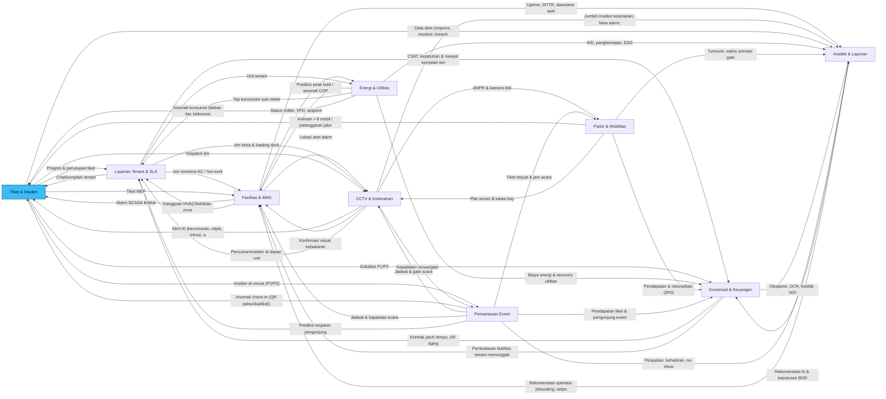

**Tiket & Insiden (TIC)** adalah *hub*: setiap event dari BMS, CCTV, TEN, ENE, dan PARK yang memerlukan tindakan manusia **wajib** berakhir sebagai tiket agar SLA, eskalasi, dan pelaporan Analitik & Laporan terukur.

### Matriks relasi ringkas

| Dari \ Ke | TIC | BMS | TEN | CCTV | ENE | ANL | PARK | O360 | EVT |
|---|---|---|---|---|---|---|---|---|---|
| **TIC** | · | ● | ● | ● |  | ● |  | ● | ● |
| **BMS** | ● | · | ● | ● | ● | ● |  |  |  |
| **TEN** | ● | ● | · | ● | ● |  |  | ● |  |
| **CCTV** | ● | ● | ● | · |  | ● | ● |  | ● |
| **ENE** | ● | ● | ● |  | · | ● |  | ● |  |
| **ANL** |  | ● |  |  |  | · |  | ● |  |
| **PARK** | ● |  |  | ● |  | ● | · | ● |  |
| **O360** |  | ● | ● |  |  | ● |  | · |  |
| **EVT** | ● | ● | ● | ● |  | ● | ● | ● | · |

● = ada aliran data/aksi. Detail isi tiap relasi: sheet `2_Matriks_Relasi` dan `3_Daftar_Relasi`.

## 3. Prinsip operasi lintas dashboard

- **Satu insiden = satu tiket.** Alarm dari beberapa sumber (BMS + CCTV + chat tenant) untuk lokasi & kejadian sama digabung (merge) ke tiket induk.
- **Verifikasi visual sebelum dispatch P1/P2.** Operator membuka kamera terdekat (CCTV) maksimal 60 detik; tidak boleh menunda dispatch P1 lebih dari itu.
- **Dashboard pemilik aset melakukan mitigasi teknis**, dashboard TIC mencatat status. Contoh: start chiller standby dilakukan di BMS, status DISPATCHED/RESOLVED di TIC.
- **Tenant selalu diberi tahu** bila zona tenant terdampak (TEN broadcast), paling lambat T+10 untuk P2 dan T+3 untuk P1.
- **Tidak ada tiket ditutup tanpa bukti**: foto sesudah, sensor normal (BMS/ENE), atau kamera aman (CCTV).
- **Analitik & Laporan hanya membaca** (consumer). Semua KPI dihitung dari event; tidak ada input manual angka KPI.
- **Komersial & Keuangan menerima eskalasi P1 otomatis** (detik ke-1) dan P2 bila melewati 15 menit.

### Status siklus tiket

```
OPEN -> ACKNOWLEDGED -> DISPATCHED -> ON-SITE -> RESOLVED -> CLOSED
                 \-> ESCALATED (paralel, tidak menghentikan siklus)
```

## 4. Matriks SLA & eskalasi

| Level | Kategori | Contoh | Respons | Resolusi | PIC | Eskalasi owner |
|---|---|---|---|---|---|---|
| **P1 CRITICAL** | Keselamatan jiwa & kebakaran | Titik api di dapur F&B, gempa bumi, ancaman teror/keamanan | 2 menit | < 15 menit (evakuasi) | Chief Security, ERT (Emergency Team) & Damkar | Langsung, detik ke-1 via WhatsApp/call prioritas |
| **P2 HIGH** | Kegagalan utilitas utama | Pemadaman PLN (genset gagal sinkron), chiller utama trip, pipa utama pecah | 5 menit | < 30 menit | Chief Engineering & Teknisi MEP Siaga | Jika belum pulih dalam 15 menit |
| **P3 MEDIUM** | Gangguan operasional area | Eskalator berhenti, antrean gate parkir macet >10 mobil, lift macet | 10 menit | < 2 jam | Supervisor Teknisi / Koordinator Parkir | Laporan rekap harian (kecuali viral di medsos) |
| **P4 LOW** | Kenyamanan & kebersihan | Toilet bau/tisu habis, tumpahan minuman di koridor, suhu zona agak panas | 15 menit | < 45 menit | Tim Housekeeping & Teknisi Zona | Rekap bulanan evaluasi vendor |

**Eskalasi berjenjang**

| Prioritas | Tahap | T+ | Dari → Ke | Kanal | Kondisi |
|---|---|---|---|---|---|
| P1 | L0 Deteksi | 0 mnt | CCO -> CSEC + ERT | Radio HT CH-01 + Pop-up Command Center | Alarm FACP/Thermal/Panic Button terverifikasi |
| P1 | L1 Manajemen | 1 mnt | SL -> GM | Call prioritas + WhatsApp Grup Crisis | Otomatis untuk semua P1 |
| P1 | L2 Direksi | 2 mnt | GM -> BOD / Owner | Call prioritas + WhatsApp | Otomatis untuk semua P1 (detik ke-1 notifikasi sistem) |
| P1 | L3 Eksternal | 3 mnt | CSEC -> Damkar / Polisi / Ambulans | Telepon 112 / 113 / 110 | Api/ancaman tidak terkendali APAR atau ada korban |
| P1 | L4 Komunikasi publik | 30 mnt | GM -> PR | Holding statement medsos & media | Insiden terlihat publik / viral |
| P2 | L0 Deteksi | 0 mnt | CCO -> CENG + MEP Siaga | Radio HT CH-02 + Tiket otomatis | BMS SCADA critical alert |
| P2 | L1 Manajemen | 15 mnt | CENG -> GM | Call + WhatsApp | Belum pulih dalam 15 menit |
| P2 | L2 Direksi | 30 mnt | GM -> BOD | WhatsApp + email ringkas | Belum pulih dalam 30 menit / dampak > 25% tenant |
| P2 | L3 Eksternal | 15 mnt | CENG -> PLN / Vendor OEM | Hotline vendor/PLN | Gangguan di sisi suplai/garansi OEM |
| P3 | L0 Deteksi | 0 mnt | CCO -> Supervisor Teknisi / PKR | Radio HT + Tiket | PLC fault code / ANPR queue alert |
| P3 | L1 Shift Lead | 60 mnt | Supervisor -> SL | Tiket eskalasi | Belum selesai 60 menit |
| P3 | L2 Manajemen | 120 mnt | SL -> GM | Rekap harian | SLA 2 jam terlampaui atau viral di medsos (langsung) |
| P4 | L0 Deteksi | 0 mnt | CCO -> HK / Teknisi Zona | Patroli App push | Sensor NH3 / QR feedback / patroli |
| P4 | L1 Supervisor | 30 mnt | HK -> SL | Patroli App | Belum selesai 30 menit |
| P4 | L2 Review vendor | Bulanan | SL -> GM (rekap bulanan) | Laporan evaluasi vendor | Akumulasi breach bulanan |

## 5. Prosedur rutin Command Center

### SOP-CC-05: Serah terima shift (shift handover) Command Center

*Trigger:* Pergantian shift A (07-15), B (15-23), C (23-07) · *PIC:* Shift Lead Ops Command Center · *KPI:* Handover selesai < 15 menit; 0 tiket tanpa PIC setelah handover

1. **[SL · TIC · H-15 menit]** Generate ringkasan otomatis: tiket aktif per prioritas, SLA at risk, alarm BMS aktif, kamera offline. → _Ringkasan handover_
2. **[SL · BMS · H-10 menit]** Cek kesehatan sistem: latensi mesh, node IoT live, NVR, SCADA, radio. Catat yang degradasi. → _Status sistem_
3. **[SL · TEN · H-5 menit]** Briefing tatap muka dengan shift masuk: insiden P1/P2, pekerjaan izin kerja tenant malam, event atrium. → _Notulen briefing_
4. **[SL · TIC · H+0]** Re-assign PIC tiket aktif ke personel shift baru; tanda tangan digital kedua Shift Lead. → _Form handover_

### SOP-CC-01: Triage, klasifikasi severity & pembuatan tiket

*Trigger:* Setiap alarm sensor, laporan tenant/pengunjung, temuan patroli, atau panggilan radio · *PIC:* Operator Command Center (Dispatcher) · *KPI:* % tiket terklasifikasi benar (target >= 98%), waktu pembuatan tiket < 60 detik

1. **[CCO · TIC · T+0]** Terima event dari sumber (pop-up alarm, chat tenant, QR, radio). Catat jam deteksi (T0). → _Event masuk antrian_
2. **[CCO · TIC · T+0:30]** Cek duplikasi: cari tiket aktif di zona & kategori yang sama dalam 30 menit terakhir; gabungkan bila duplikat. → _Tiket baru / merge_
3. **[CCO · CCTV · T+1]** Verifikasi visual via kamera terdekat (auto-suggest CCTV per zona) atau konfirmasi radio patroli. → _Screenshot verifikasi_
4. **[CCO · TIC · T+1]** Tetapkan prioritas memakai matriks: P1 jiwa/kebakaran, P2 utilitas utama, P3 gangguan area, P4 kenyamanan. → _Prioritas & SLA timer aktif_
5. **[CCO · TIC · T+1:30]** Lengkapi field wajib: kategori domain, zona/lantai, tenant (jika ada), sumber, SOP terkait (auto-map). → _Tiket lengkap_
6. **[CCO · TIC · T+2]** Jalankan SOP spesifik sesuai kategori (lihat kolom SOP terkait) & dispatch tim (SOP-CC-02). → _Status DISPATCHED_
7. **[SL · ANL · Akhir shift]** Audit sampling 10% tiket per shift untuk ketepatan klasifikasi; koreksi & coaching operator. → _Log audit klasifikasi_

### SOP-CC-02: Dispatch & penugasan tim lapangan

*Trigger:* Tiket berstatus OPEN/ACKNOWLEDGED · *PIC:* Operator Command Center (Dispatcher) · *KPI:* Waktu dispatch <= target respons SLA; ETA tim akurat +/- 1 menit

1. **[CCO · TIC · T+0]** Lihat panel kesiapan tim reaksi cepat; pilih tim terdekat dengan skill sesuai (MEP/Security/HK/Parkir). → _Tim terpilih_
2. **[CCO · TIC · T+0:30]** Kirim penugasan via Patroli App + radio channel sesuai domain (CH-01 Security, CH-02 MEP, CH-03 HK, CH-04 Parkir). → _Penugasan terkirim_
3. **[QRT · TIC · T+1]** Tim membalas 'COPY' dan berangkat; status otomatis ON-THE-WAY dengan ETA dari GPS. → _Status ON-THE-WAY_
4. **[CCO · CCTV · Kontinu]** Pantau pergerakan tim via kamera rute; arahkan jalur tercepat (lift servis/tangga darurat). → _Log pergerakan_
5. **[QRT · TIC · <= SLA respons]** Tiba di lokasi, tap NFC checkpoint terdekat, unggah foto kondisi awal. → _Status ON-SITE + foto_
6. **[CCO · TIC · T+1]** Jika tim tidak merespons 60 detik, re-dispatch ke tim cadangan & catat ke log kinerja vendor. → _Re-dispatch log_

### SOP-CC-03: Matriks eskalasi berjenjang & komunikasi krisis

*Trigger:* SLA respons/resolusi terlampaui atau kriteria eskalasi otomatis (P1) · *PIC:* Shift Lead Ops Command Center · *KPI:* 100% P1 tereskalasi ke GM < 1 menit; 0 eskalasi terlewat

1. **[CCO · TIC · 80% SLA]** Sistem menandai tiket 'SLA AT RISK' pada 80% waktu SLA; operator verifikasi kendala dengan tim lapangan. → _Flag AT RISK_
2. **[SL · TIC · T+1]** Untuk P1: konfirmasi panggilan prioritas ke GM tersambung; bila tidak, telepon Deputy GM. → _ACK GM_
3. **[SL · TIC · T+15]** Untuk P2: eskalasi ke GM jika belum pulih 15 menit; sertakan root cause awal & ETA. → _Pesan eskalasi_
4. **[GM · ANL · T+5 (P1)]** Putuskan aktivasi Crisis Team & kebutuhan eskalasi ke Direksi/Owner serta pihak eksternal. → _Keputusan krisis_
5. **[PR · ANL · T+30]** Siapkan holding statement jika insiden terlihat publik/viral (P1 atau P3 viral). → _Draft statement_
6. **[SL · ANL · Harian]** Rekap eskalasi harian & bulanan dikirim otomatis ke GM; review di rapat operasional mingguan. → _Laporan eskalasi_

### SOP-CC-04: Penutupan tiket, verifikasi bukti & root cause analysis

*Trigger:* Tim lapangan menandai RESOLVED · *PIC:* Shift Lead Ops Command Center · *KPI:* First Contact Resolution >= 90%; reopen rate < 3%

1. **[MEP · TIC · Saat selesai]** Tim lapangan unggah foto sesudah perbaikan & catatan tindakan (parts, durasi). → _Foto sesudah_
2. **[CCO · BMS · +5 menit]** Verifikasi: sensor/BMS kembali normal, kamera menunjukkan area aman, pelapor (tenant/pengunjung) konfirmasi. → _Checklist verifikasi_
3. **[CCO · TEN · +5 menit]** Ubah status ke CLOSED; sistem kirim survei CSAT ke pelapor (tenant via app, pengunjung via QR). → _Survei CSAT_
4. **[SL · ANL · <= 48 jam]** P1/P2 atau tiket berulang (>= 3x/30 hari): wajib RCA 5-Why dalam 48 jam. → _Dokumen RCA_
5. **[CENG · BMS · <= 7 hari]** Tindak lanjut preventif (work order PM, perubahan setpoint, penggantian aset) dicatat & ditautkan. → _Work order PM_

### SOP-CC-06: Mode degradasi: sensor / sistem offline

*Trigger:* Node IoT offline > 5%, NVR/SCADA tidak sinkron > 2 menit, latensi mesh > 200 ms · *PIC:* IT/OT Engineer · *KPI:* Pemulihan sistem kritikal < 30 menit; 0 insiden tak terdeteksi selama degradasi

1. **[IT · TIC · T+0]** Sistem memunculkan banner DEGRADED MODE dan daftar node/kamera offline per zona. → _Banner degradasi_
2. **[SL · CCTV · T+5]** Aktifkan patroli manual & radio check 15 menit sekali di zona tanpa sensor. → _Jadwal patroli manual_
3. **[IT · BMS · T+10]** Diagnosa: switch, PoE, gateway LoRaWAN, server VMS/SCADA; failover ke server cadangan. → _Hasil diagnosa_
4. **[IT · TIC · T+30]** Eskalasi ke vendor sistem jika belum pulih 30 menit (P2). → _Tiket vendor_
5. **[IT · ANL · Setelah pulih]** Validasi data backfill & catat periode blind-spot di laporan harian. → _Laporan blind-spot_

## 6. Runbook per use case

| UC | Nama | Prioritas | Dashboard utama | Dashboard terkait | SOP |
|---|---|---|---|---|---|
| [UC-01](#uc-01) | Kebocoran pipa chiller & genangan di atrium | P2 | BMS | TIC, CCTV, TEN, ENE, ANL | SOP-BMS-02, SOP-BMS-01, SOP-CC-02 |
| [UC-02](#uc-02) | Eskalator trip (comb-plate) di area ramai | P3 | BMS | TIC, CCTV, ANL | SOP-BMS-05, SOP-CC-02 |
| [UC-03](#uc-03) | Komplain suhu tenant anchor (Zara GF-104) | P2 | TEN | TIC, BMS, ENE, O360 | SOP-COM-05, SOP-BMS-01 |
| [UC-04](#uc-04) | Kebakaran dapur F&B (Code Red) | P1 | CCTV | TIC, BMS, TEN, PARK, ANL, O360 | SOP-SEC-01, SOP-CC-03 |
| [UC-05](#uc-05) | Orang dalam pengawasan & barang tak bertuan | P2 | CCTV | TIC, TEN, ANL | SOP-SEC-04, SOP-SEC-03 |
| [UC-06](#uc-06) | Antrean gate parkir utama > 8 mobil | P3 | PARK | TIC, CCTV, ANL | SOP-PRK-01 |
| [UC-07](#uc-07) | Peak load WBP & peak shaving otomatis | P3 | ENE | BMS, TEN, ANL, O360 | SOP-BMS-04 |
| [UC-08](#uc-08) | Pemadaman PLN & genset gagal sinkron | P2 | BMS | TIC, CCTV, ENE, TEN, O360, ANL | SOP-BMS-03, SOP-BMS-05, SOP-CC-03 |
| [UC-09](#uc-09) | Toilet bau (NH3) & feedback QR pengunjung | P4 | TIC | CCTV, ANL | SOP-SEC-07, SOP-VIS-03 |
| [UC-10](#uc-10) | Tenant menunggak > 60 hari | - | O360 | TEN, BMS, ANL | SOP-FIN-02 |
| [UC-11](#uc-11) | Izin overtime AC & loading dock tenant malam | P3 | TEN | BMS, CCTV, ENE, O360 | SOP-COM-06, SOP-COM-02 |
| [UC-12](#uc-12) | Kebocoran air malam hari (flow anomali) | P2 | ENE | TIC, BMS, CCTV | SOP-BMS-02 |
| [UC-13](#uc-13) | Kerumunan event atrium melebihi kapasitas | P2 | CCTV | TIC, BMS, O360, PARK | SOP-VIS-01, SOP-COM-04 |
| [UC-14](#uc-14) | Predictive maintenance eskalator sebelum akhir pekan | P3 | BMS | TIC, ANL | SOP-BMS-06 |
| [UC-15](#uc-15) | Anak hilang (Code Adam) | P1 | TIC | CCTV, PARK, TEN | SOP-SEC-09 |
| [UC-16](#uc-16) | Laporan BOD bulanan gabungan | - | ANL | O360, TIC, BMS, ENE, TEN, CCTV, PARK | SOP-FIN-04, SOP-FIN-03 |
| [UC-17](#uc-17) | Hari-H acara atrium: indikasi tiket palsu & lonjakan check-in | P2 | EVT | TIC, CCTV, PARK, ANL | SOP-EVT-03, SOP-EVT-01 |
| [UC-18](#uc-18) | Rebutan kursi & pembayaran gagal saat penjualan dibuka | P3 | EVT | TIC, O360, ANL | SOP-EVT-02, SOP-EVT-04 |

### UC-01
#### Kebocoran pipa chiller & genangan di atrium

- **Trigger:** Sensor tekanan CHW turun + laporan genangan di UG Main Atrium
- **Prioritas:** P2 · **Dashboard utama:** Fasilitas & BMS · **Terkait:** TIC, CCTV, TEN, ENE, ANL
- **SOP acuan:** SOP-BMS-02, SOP-BMS-01, SOP-CC-02
- **Aktor:** BMSO (Operator BMS), CCO (Operator Command Center (Dispatcher)), MEP (Teknisi MEP Siaga), HK (Supervisor Housekeeping), TRO (Tenant Relation Officer), ENM (Energy Manager)
- **Kriteria sukses:** Kebocoran terisolasi <= 10 menit, tanpa pengunjung terpeleset, tenant sekitar terinformasi
- **Tiket:** "Kebocoran pipa chiller & genangan air" · lokasi LG Main Atrium · sumber BMS SCADA #BMS-CH-04 · kamera CAM-17

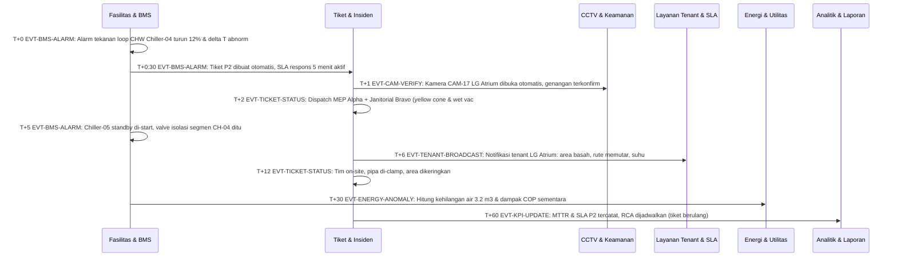

| # | T+ | Dari → Ke | Event | Aktor | Aksi | Data |
|---|---|---|---|---|---|---|
| 1 | T+0 | BMS | `EVT-BMS-ALARM` | BMSO | Alarm tekanan loop CHW Chiller-04 turun 12% & delta T abnormal | asset=CH-04, P=3.1 bar |
| 2 | T+0:30 | BMS → TIC | `EVT-BMS-ALARM` | CCO | Tiket P2 dibuat otomatis, SLA respons 5 menit aktif | ticket, aset, zona LG |
| 3 | T+1 | TIC → CCTV | `EVT-CAM-VERIFY` | CCO | Kamera CAM-17 LG Atrium dibuka otomatis, genangan terkonfirmasi | cam=CAM-17 |
| 4 | T+2 | TIC | `EVT-TICKET-STATUS` | CCO | Dispatch MEP Alpha + Janitorial Bravo (yellow cone & wet vac) | team, ETA 3 menit |
| 5 | T+5 | BMS | `EVT-BMS-ALARM` | BMSO | Chiller-05 standby di-start, valve isolasi segmen CH-04 ditutup | CH-05 RUNNING |
| 6 | T+6 | TIC → TEN | `EVT-TENANT-BROADCAST` | TRO | Notifikasi tenant LG Atrium: area basah, rute memutar, suhu dapat naik sementara | zone=LG |
| 7 | T+12 | TIC | `EVT-TICKET-STATUS` | MEP | Tim on-site, pipa di-clamp, area dikeringkan | foto sesudah |
| 8 | T+30 | BMS → ENE | `EVT-ENERGY-ANOMALY` | ENM | Hitung kehilangan air 3.2 m3 & dampak COP sementara | m3, kWh |
| 9 | T+60 | TIC → ANL | `EVT-KPI-UPDATE` | SL | MTTR & SLA P2 tercatat; RCA dijadwalkan (tiket berulang) | mttr=12m |

**Titik keputusan & eskalasi**

- Bila belum pulih 15 menit → eskalasi GM (L1). 30 menit → Direksi (L2).
- Bila ada korban/risiko jiwa → naikkan ke P1 dan ikuti SOP-SEC terkait.

**Verifikasi penutupan:** Pipa diperbaiki, area kering, tekanan normal.

### UC-02
#### Eskalator trip (comb-plate) di area ramai

- **Trigger:** PLC fault code comb-plate eskalator E-04 West Atrium
- **Prioritas:** P3 · **Dashboard utama:** Fasilitas & BMS · **Terkait:** TIC, CCTV, ANL
- **SOP acuan:** SOP-BMS-05, SOP-CC-02
- **Aktor:** BMSO (Operator BMS), CCO (Operator Command Center (Dispatcher)), QRT (Security Quick Response Team), MEP (Teknisi MEP Siaga), CENG (Chief Engineering)
- **Kriteria sukses:** Area aman <= 3 menit, tidak ada korban, eskalator kembali beroperasi <= 2 jam
- **Tiket:** "Eskalator E-04 mati mendadak (emergency trip)" · lokasi 2F West Atrium E-04 · sumber PLC Fault Code ESC-E04 · kamera CAM-29

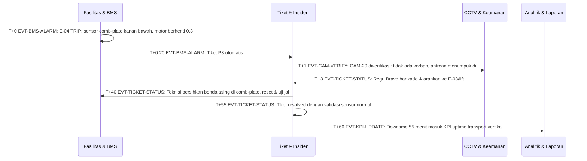

| # | T+ | Dari → Ke | Event | Aktor | Aksi | Data |
|---|---|---|---|---|---|---|
| 1 | T+0 | BMS | `EVT-BMS-ALARM` | BMSO | E-04 TRIP: sensor comb-plate kanan bawah, motor berhenti 0.32 detik | fault=CP-R |
| 2 | T+0:20 | BMS → TIC | `EVT-BMS-ALARM` | CCO | Tiket P3 otomatis | ticket |
| 3 | T+1 | TIC → CCTV | `EVT-CAM-VERIFY` | CCO | CAM-29 diverifikasi: tidak ada korban, antrean menumpuk di landing | cam=CAM-29 |
| 4 | T+3 | CCTV → TIC | `EVT-TICKET-STATUS` | QRT | Regu Bravo barikade & arahkan ke E-03/lift | team |
| 5 | T+40 | TIC → BMS | `EVT-TICKET-STATUS` | MEP | Teknisi bersihkan benda asing di comb-plate, reset & uji jalan | uji 10 menit |
| 6 | T+55 | TIC | `EVT-TICKET-STATUS` | CCO | Tiket resolved dengan validasi sensor normal | - |
| 7 | T+60 | TIC → ANL | `EVT-KPI-UPDATE` | CENG | Downtime 55 menit masuk KPI uptime transport vertikal | downtime |

**Titik keputusan & eskalasi**

- Bila belum selesai 60 menit → eskalasi Shift Lead; 2 jam → GM.
- Bila viral di media sosial → langsung eskalasi GM & PR (SOP-VIS-04).

**Verifikasi penutupan:** Unit uji jalan aman & dibuka kembali.

### UC-03
#### Komplain suhu tenant anchor (Zara GF-104)

- **Trigger:** Store manager mengirim komplain suhu fitting room 28 C via WhatsApp
- **Prioritas:** P2 · **Dashboard utama:** Layanan Tenant & SLA · **Terkait:** TIC, BMS, ENE, O360
- **SOP acuan:** SOP-COM-05, SOP-BMS-01
- **Aktor:** TRO (Tenant Relation Officer), CCO (Operator Command Center (Dispatcher)), MEP (Teknisi MEP Siaga), BMSO (Operator BMS), ENM (Energy Manager)
- **Kriteria sukses:** Suhu kembali <= 24 C <= 30 menit, tenant memberikan CSAT
- **Tiket:** "Tenant Zara (GF-104): suhu AC 28 C" · lokasi GF Luxury Wing Unit GF-104 · sumber WhatsApp Tenant · kamera CAM-14

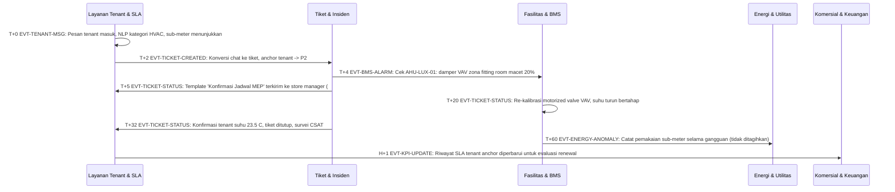

| # | T+ | Dari → Ke | Event | Aktor | Aksi | Data |
|---|---|---|---|---|---|---|
| 1 | T+0 | TEN | `EVT-TENANT-MSG` | TRO | Pesan tenant masuk; NLP kategori HVAC; sub-meter menunjukkan 24.8 C (+3.8 delta) | tenant=GF-104 |
| 2 | T+2 | TEN → TIC | `EVT-TICKET-CREATED` | TRO | Konversi chat ke tiket; anchor tenant -> P2 | ticket |
| 3 | T+4 | TIC → BMS | `EVT-BMS-ALARM` | BMSO | Cek AHU-LUX-01: damper VAV zona fitting room macet 20% | AHU-LUX |
| 4 | T+5 | TIC → TEN | `EVT-TICKET-STATUS` | CCO | Template 'Konfirmasi Jadwal MEP' terkirim ke store manager (ETA 15 menit) | - |
| 5 | T+20 | BMS | `EVT-TICKET-STATUS` | MEP | Re-kalibrasi motorized valve VAV; suhu turun bertahap | - |
| 6 | T+32 | TIC → TEN | `EVT-TICKET-STATUS` | TRO | Konfirmasi tenant suhu 23.5 C; tiket ditutup; survei CSAT | csat=5 |
| 7 | T+60 | BMS → ENE | `EVT-ENERGY-ANOMALY` | ENM | Catat pemakaian sub-meter selama gangguan (tidak ditagihkan) | - |
| 8 | H+1 | TEN → O360 | `EVT-KPI-UPDATE` | LSG | Riwayat SLA tenant anchor diperbarui untuk evaluasi renewal | - |

**Titik keputusan & eskalasi**

- Bila belum pulih 15 menit → eskalasi GM (L1). 30 menit → Direksi (L2).
- Bila ada korban/risiko jiwa → naikkan ke P1 dan ikuti SOP-SEC terkait.

**Verifikasi penutupan:** Tenant konfirmasi selesai + CSAT terisi.

### UC-04
#### Kebakaran dapur F&B (Code Red)

- **Trigger:** FACP smoke+heat detector dapur Food Court 3F + thermal CCTV
- **Prioritas:** P1 · **Dashboard utama:** CCTV & Keamanan · **Terkait:** TIC, BMS, TEN, PARK, ANL, O360
- **SOP acuan:** SOP-SEC-01, SOP-CC-03
- **Aktor:** CCO (Operator Command Center (Dispatcher)), CSEC (Chief Security), ERT (Emergency Response Team (ERT)), BMSO (Operator BMS), TRO (Tenant Relation Officer), PKR (Koordinator Parkir), GM (General Manager Mall), BOD (Direksi / Owner), HSE (HSE Officer)
- **Kriteria sukses:** Api padam / evakuasi zona < 15 menit, 0 korban, owner terinformasi detik pertama
- **Tiket:** "Alarm kebakaran dapur F&B Food Court 3F" · lokasi 3F Food Court - Dapur Unit L3-22 · sumber FACP Zone 3F-FC-07 + Thermal CAM-08 · kamera CAM-08

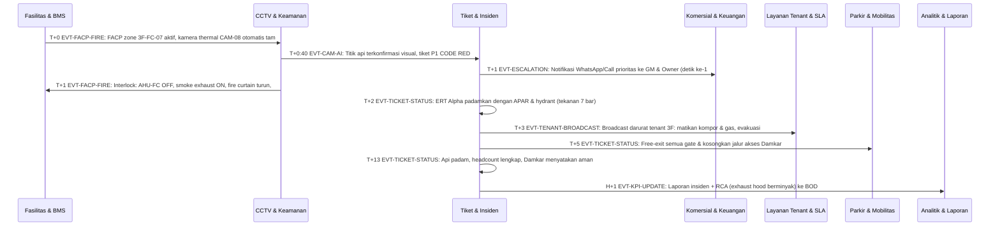

| # | T+ | Dari → Ke | Event | Aktor | Aksi | Data |
|---|---|---|---|---|---|---|
| 1 | T+0 | BMS → CCTV | `EVT-FACP-FIRE` | CCO | FACP zone 3F-FC-07 aktif; kamera thermal CAM-08 otomatis tampil fullscreen | detector=3F-FC-07 |
| 2 | T+0:40 | CCTV → TIC | `EVT-CAM-AI` | CCO | Titik api terkonfirmasi visual; tiket P1 CODE RED | ticket |
| 3 | T+1 | TIC → O360 | `EVT-ESCALATION` | SL | Notifikasi WhatsApp/Call prioritas ke GM & Owner (detik ke-1) | level=L1+L2 |
| 4 | T+1 | CCTV → BMS | `EVT-FACP-FIRE` | BMSO | Interlock: AHU-FC OFF, smoke exhaust ON, fire curtain turun, lift recall | AHU-FC |
| 5 | T+2 | TIC | `EVT-TICKET-STATUS` | ERT | ERT Alpha padamkan dengan APAR & hydrant (tekanan 7 bar) | - |
| 6 | T+3 | TIC → TEN | `EVT-TENANT-BROADCAST` | TRO | Broadcast darurat tenant 3F: matikan kompor & gas, evakuasi karyawan | zone=3F |
| 7 | T+5 | TIC → PARK | `EVT-TICKET-STATUS` | PKR | Free-exit semua gate & kosongkan jalur akses Damkar | gate=ALL |
| 8 | T+13 | TIC | `EVT-TICKET-STATUS` | CSEC | Api padam, headcount lengkap, Damkar menyatakan aman | - |
| 9 | H+1 | TIC → ANL | `EVT-KPI-UPDATE` | HSE | Laporan insiden + RCA (exhaust hood berminyak) ke BOD | - |

**Titik keputusan & eskalasi**

- Bila verifikasi visual > 60 detik belum selesai → dispatch tetap jalan (asumsikan nyata).
- Eskalasi GM & Owner otomatis detik ke-1; Shift Lead memastikan ACK.
- Bila tidak terkendali dalam 3 menit → panggil pihak eksternal (Damkar 113 / Polisi 110 / Ambulans 118/119).

**Verifikasi penutupan:** Damkar menyatakan aman; sistem fire di-reset.

### UC-05
#### Orang dalam pengawasan & barang tak bertuan

- **Trigger:** AI Face Recognition watchlist #WL-402 di Atrium GF + objek tak bertuan di Koridor 2F
- **Prioritas:** P2 · **Dashboard utama:** CCTV & Keamanan · **Terkait:** TIC, TEN, ANL
- **SOP acuan:** SOP-SEC-04, SOP-SEC-03
- **Aktor:** CCO (Operator Command Center (Dispatcher)), CSEC (Chief Security), QRT (Security Quick Response Team), TRO (Tenant Relation Officer), CS (Customer Service / Information Desk)
- **Kriteria sukses:** Intersep <= 5 menit; objek diklarifikasi <= 15 menit
- **Tiket:** "Deteksi orang dalam pengawasan (#WL-402) Atrium GF" · lokasi GF Atrium dekat Rolex · sumber AI FR CAM-01 · kamera CAM-01

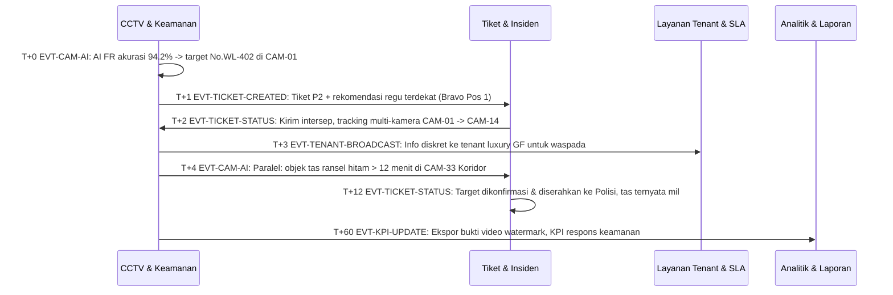

| # | T+ | Dari → Ke | Event | Aktor | Aksi | Data |
|---|---|---|---|---|---|---|
| 1 | T+0 | CCTV | `EVT-CAM-AI` | CCO | AI FR akurasi 94.2% -> target #WL-402 di CAM-01 | conf=0.942 |
| 2 | T+1 | CCTV → TIC | `EVT-TICKET-CREATED` | CCO | Tiket P2 + rekomendasi regu terdekat (Bravo Pos 1) | ticket |
| 3 | T+2 | TIC → CCTV | `EVT-TICKET-STATUS` | QRT | Kirim intersep; tracking multi-kamera CAM-01 -> CAM-14 | - |
| 4 | T+3 | CCTV → TEN | `EVT-TENANT-BROADCAST` | TRO | Info diskret ke tenant luxury GF untuk waspada | zone=GF |
| 5 | T+4 | CCTV → TIC | `EVT-CAM-AI` | CCO | Paralel: objek tas ransel hitam > 12 menit di CAM-33 Koridor 2F -> SOP-SEC-03 | cam=CAM-33 |
| 6 | T+12 | TIC | `EVT-TICKET-STATUS` | CSEC | Target dikonfirmasi & diserahkan ke Polisi; tas ternyata milik pengunjung (Lost & Found) | - |
| 7 | T+60 | CCTV → ANL | `EVT-KPI-UPDATE` | CSEC | Ekspor bukti video watermark; KPI respons keamanan | - |

**Titik keputusan & eskalasi**

- Bila belum pulih 15 menit → eskalasi GM (L1). 30 menit → Direksi (L2).
- Bila ada korban/risiko jiwa → naikkan ke P1 dan ikuti SOP-SEC terkait.

**Verifikasi penutupan:** Pelaku diamankan/diserahkan ke Polisi atau alarm diklarifikasi.

### UC-06
#### Antrean gate parkir utama > 8 mobil

- **Trigger:** ANPR queue alert gate P1 Utara saat jam makan siang akhir pekan
- **Prioritas:** P3 · **Dashboard utama:** Parkir & Mobilitas · **Terkait:** TIC, CCTV, ANL
- **SOP acuan:** SOP-PRK-01
- **Aktor:** PKR (Koordinator Parkir), CCO (Operator Command Center (Dispatcher)), QRT (Security Quick Response Team)
- **Kriteria sukses:** Antrean terurai <= 10 menit tanpa meluber ke jalan raya
- **Tiket:** "Antrean gate masuk P1 Utara 11 mobil" · lokasi Gate Masuk P1 Utara · sumber ANPR CAM-61 · kamera CAM-61

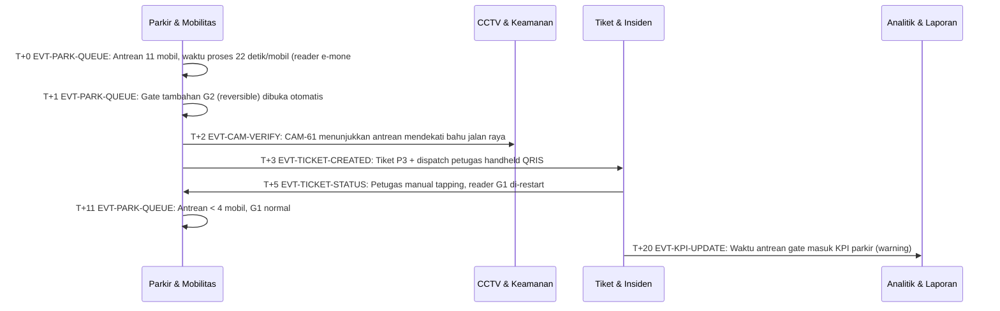

| # | T+ | Dari → Ke | Event | Aktor | Aksi | Data |
|---|---|---|---|---|---|---|
| 1 | T+0 | PARK | `EVT-PARK-QUEUE` | PKR | Antrean 11 mobil, waktu proses 22 detik/mobil (reader e-money lambat) | gate=G1 |
| 2 | T+1 | PARK | `EVT-PARK-QUEUE` | PKR | Gate tambahan G2 (reversible) dibuka otomatis | gate=G2 |
| 3 | T+2 | PARK → CCTV | `EVT-CAM-VERIFY` | CCO | CAM-61 menunjukkan antrean mendekati bahu jalan raya | - |
| 4 | T+3 | PARK → TIC | `EVT-TICKET-CREATED` | CCO | Tiket P3 + dispatch petugas handheld QRIS | ticket |
| 5 | T+5 | TIC → PARK | `EVT-TICKET-STATUS` | PKR | Petugas manual tapping; reader G1 di-restart | - |
| 6 | T+11 | PARK | `EVT-PARK-QUEUE` | PKR | Antrean < 4 mobil; G1 normal | - |
| 7 | T+20 | TIC → ANL | `EVT-KPI-UPDATE` | PKR | Waktu antrean gate masuk KPI parkir (warning) | - |

**Titik keputusan & eskalasi**

- Bila belum selesai 60 menit → eskalasi Shift Lead; 2 jam → GM.
- Bila viral di media sosial → langsung eskalasi GM & PR (SOP-VIS-04).

**Verifikasi penutupan:** Antrean < 4 mobil selama 15 menit.

### UC-07
#### Peak load WBP & peak shaving otomatis

- **Trigger:** Prediksi beban 15.6 MW mendekati batas kontrak 16.5 MVA pukul 18:30
- **Prioritas:** P3 · **Dashboard utama:** Energi & Utilitas · **Terkait:** BMS, TEN, ANL, O360
- **SOP acuan:** SOP-BMS-04
- **Aktor:** ENM (Energy Manager), BMSO (Operator BMS), TRO (Tenant Relation Officer), FIN (Finance AR & Billing)
- **Kriteria sukses:** Beban < 85% kontrak sepanjang WBP; hemat biaya >= Rp 18 Jt/sesi
- **Tiket:** "Prediksi peak load WBP 18:00-22:00" · lokasi Gardu Induk B1 · sumber Smart Power Meter PLN

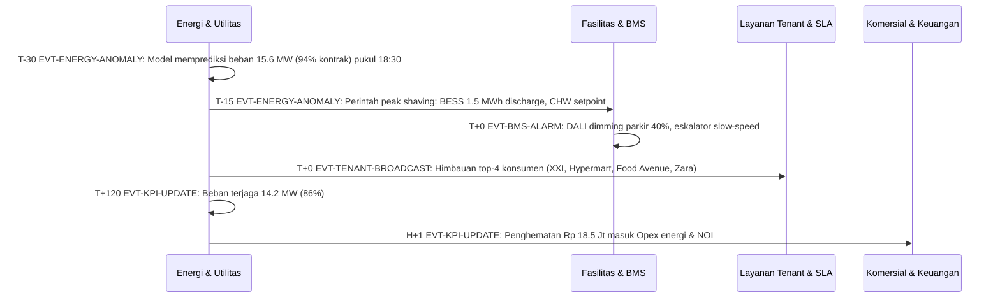

| # | T+ | Dari → Ke | Event | Aktor | Aksi | Data |
|---|---|---|---|---|---|---|
| 1 | T-30 | ENE | `EVT-ENERGY-ANOMALY` | ENM | Model memprediksi beban 15.6 MW (94% kontrak) pukul 18:30 | kw=15600 |
| 2 | T-15 | ENE → BMS | `EVT-ENERGY-ANOMALY` | BMSO | Perintah peak shaving: BESS 1.5 MWh discharge, CHW setpoint +0.5 C | - |
| 3 | T+0 | BMS | `EVT-BMS-ALARM` | BMSO | DALI dimming parkir 40%, eskalator slow-speed | - |
| 4 | T+0 | ENE → TEN | `EVT-TENANT-BROADCAST` | TRO | Himbauan top-4 konsumen (XXI, Hypermart, Food Avenue, Zara) kurangi beban non-esensial | - |
| 5 | T+120 | ENE | `EVT-KPI-UPDATE` | ENM | Beban terjaga 14.2 MW (86%) | - |
| 6 | H+1 | ENE → O360 | `EVT-KPI-UPDATE` | FIN | Penghematan Rp 18.5 Jt masuk Opex energi & NOI | - |

**Titik keputusan & eskalasi**

- Bila belum selesai 60 menit → eskalasi Shift Lead; 2 jam → GM.
- Bila viral di media sosial → langsung eskalasi GM & PR (SOP-VIS-04).

**Verifikasi penutupan:** Beban < 85% batas kontrak.

### UC-08
#### Pemadaman PLN & genset gagal sinkron

- **Trigger:** Tegangan PLN 20 kV hilang, ATS transfer, Genset 03 gagal sinkron
- **Prioritas:** P2 · **Dashboard utama:** Fasilitas & BMS · **Terkait:** TIC, CCTV, ENE, TEN, O360, ANL
- **SOP acuan:** SOP-BMS-03, SOP-BMS-05, SOP-CC-03
- **Aktor:** BMSO (Operator BMS), CCO (Operator Command Center (Dispatcher)), MEP (Teknisi MEP Siaga), QRT (Security Quick Response Team), CENG (Chief Engineering), TRO (Tenant Relation Officer), GM (General Manager Mall)
- **Kriteria sukses:** Daya kritikal pulih <= 30 menit; tidak ada penumpang lift terjebak > 15 menit
- **Tiket:** "Pemadaman PLN, Genset 03 gagal sinkron" · lokasi Gardu Trafo B1 / Genset Room · sumber ATS & Genset Controller · kamera CAM-88

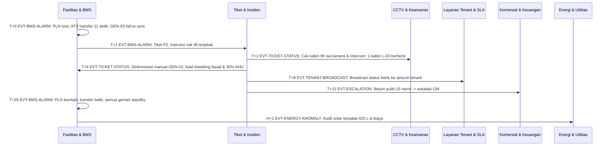

| # | T+ | Dari → Ke | Event | Aktor | Aksi | Data |
|---|---|---|---|---|---|---|
| 1 | T+0 | BMS | `EVT-BMS-ALARM` | BMSO | PLN loss; ATS transfer 11 detik; GEN-03 fail-to-sync | - |
| 2 | T+1 | BMS → TIC | `EVT-BMS-ALARM` | CCO | Tiket P2; instruksi cek lift terjebak | ticket |
| 3 | T+2 | TIC → CCTV | `EVT-TICKET-STATUS` | QRT | Cek kabin lift via kamera & intercom: 1 kabin L-03 berhenti antar lantai | - |
| 4 | T+6 | TIC → BMS | `EVT-TICKET-STATUS` | MEP | Sinkronisasi manual GEN-03; load shedding fasad & 30% AHU | - |
| 5 | T+8 | TIC → TEN | `EVT-TENANT-BROADCAST` | TRO | Broadcast status listrik ke seluruh tenant | - |
| 6 | T+15 | TIC → O360 | `EVT-ESCALATION` | CENG | Belum pulih 15 menit -> eskalasi GM | - |
| 7 | T+26 | BMS | `EVT-BMS-ALARM` | BMSO | PLN kembali; transfer balik; semua genset standby | - |
| 8 | H+1 | BMS → ENE | `EVT-ENERGY-ANOMALY` | ENM | Audit solar terpakai 420 L & biaya | - |

**Titik keputusan & eskalasi**

- Bila belum pulih 15 menit → eskalasi GM (L1). 30 menit → Direksi (L2).
- Bila ada korban/risiko jiwa → naikkan ke P1 dan ikuti SOP-SEC terkait.

**Verifikasi penutupan:** Suplai normal (PLN/genset) & seluruh sistem kritikal online.

### UC-09
#### Toilet bau (NH3) & feedback QR pengunjung

- **Trigger:** Sensor NH3 toilet 2F > 25 ppm + 3 scan QR 'bau'
- **Prioritas:** P4 · **Dashboard utama:** Tiket & Insiden · **Terkait:** CCTV, ANL
- **SOP acuan:** SOP-SEC-07, SOP-VIS-03
- **Aktor:** CCO (Operator Command Center (Dispatcher)), HK (Supervisor Housekeeping), CS (Customer Service / Information Desk)
- **Kriteria sukses:** Respons <= 15 menit, resolusi <= 45 menit, auto-close saat sensor normal
- **Tiket:** "Toilet pria 2F bau (NH3 32 ppm) & tisu habis" · lokasi Toilet Pria 2F Timur · sumber Smart Toilet NH3 + QR

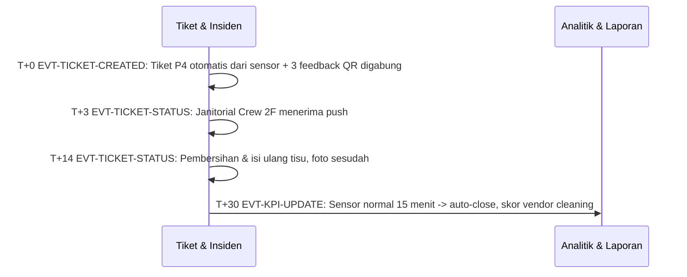

| # | T+ | Dari → Ke | Event | Aktor | Aksi | Data |
|---|---|---|---|---|---|---|
| 1 | T+0 | TIC | `EVT-TICKET-CREATED` | CCO | Tiket P4 otomatis dari sensor + 3 feedback QR digabung | ticket |
| 2 | T+3 | TIC | `EVT-TICKET-STATUS` | HK | Janitorial Crew 2F menerima push | - |
| 3 | T+14 | TIC | `EVT-TICKET-STATUS` | HK | Pembersihan & isi ulang tisu; foto sesudah | - |
| 4 | T+30 | TIC → ANL | `EVT-KPI-UPDATE` | SL | Sensor normal 15 menit -> auto-close; skor vendor cleaning | - |

**Titik keputusan & eskalasi**

- Bila belum selesai 30 menit → Supervisor; akumulasi breach masuk evaluasi vendor bulanan.

**Verifikasi penutupan:** Sensor NH3 normal / area bersih kering.

### UC-10
#### Tenant menunggak > 60 hari

- **Trigger:** AR aging tenant 2F mencapai 61 hari
- **Prioritas:** - · **Dashboard utama:** Komersial & Keuangan · **Terkait:** TEN, BMS, ANL
- **SOP acuan:** SOP-FIN-02
- **Aktor:** FIN (Finance AR & Billing), TRO (Tenant Relation Officer), GM (General Manager Mall), CENG (Chief Engineering)
- **Kriteria sukses:** Tenant melunasi / restrukturisasi; pembatasan fasilitas terkendali
- **Tiket:** "Tunggakan > 60 hari unit 2F-31" · lokasi Unit 2F-31 · sumber ERP Finance AR Aging

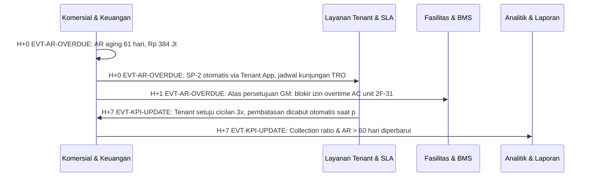

| # | T+ | Dari → Ke | Event | Aktor | Aksi | Data |
|---|---|---|---|---|---|---|
| 1 | H+0 | O360 | `EVT-AR-OVERDUE` | FIN | AR aging 61 hari, Rp 384 Jt | - |
| 2 | H+0 | O360 → TEN | `EVT-AR-OVERDUE` | TRO | SP-2 otomatis via Tenant App; jadwal kunjungan TRO | - |
| 3 | H+1 | O360 → BMS | `EVT-AR-OVERDUE` | CENG | Atas persetujuan GM: blokir izin overtime AC unit 2F-31 | - |
| 4 | H+7 | TEN → O360 | `EVT-KPI-UPDATE` | FIN | Tenant setuju cicilan 3x; pembatasan dicabut otomatis saat pembayaran pertama | - |
| 5 | H+7 | O360 → ANL | `EVT-KPI-UPDATE` | FIN | Collection ratio & AR > 60 hari diperbarui | - |

**Titik keputusan & eskalasi**

- Proses bisnis terjadwal: keputusan diambil di rapat mingguan/bulanan sesuai SOP.

**Verifikasi penutupan:** Lunas / rencana cicilan disetujui.

### UC-11
#### Izin overtime AC & loading dock tenant malam

- **Trigger:** Cinema XXI meminta overtime AC 00:00-03:00 & bongkar muat B2
- **Prioritas:** P3 · **Dashboard utama:** Layanan Tenant & SLA · **Terkait:** BMS, CCTV, ENE, O360
- **SOP acuan:** SOP-COM-06, SOP-COM-02
- **Aktor:** TRO (Tenant Relation Officer), CENG (Chief Engineering), BMSO (Operator BMS), CSEC (Chief Security), FIN (Finance AR & Billing)
- **Kriteria sukses:** Izin disetujui <= 2 jam, overtime tertagih otomatis
- **Tiket:** "Izin overtime AC & loading dock Cinema XXI" · lokasi 3F Cinema West / Dock B2 · sumber Tenant App FORM-OT-2026-884 · kamera CAM-88

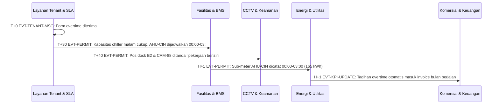

| # | T+ | Dari → Ke | Event | Aktor | Aksi | Data |
|---|---|---|---|---|---|---|
| 1 | T+0 | TEN | `EVT-TENANT-MSG` | TRO | Form overtime diterima | - |
| 2 | T+30 | TEN → BMS | `EVT-PERMIT` | CENG | Kapasitas chiller malam cukup; AHU-CIN dijadwalkan 00:00-03:00 | - |
| 3 | T+40 | TEN → CCTV | `EVT-PERMIT` | CSEC | Pos dock B2 & CAM-88 ditandai 'pekerjaan berizin' | - |
| 4 | H+1 | BMS → ENE | `EVT-PERMIT` | ENM | Sub-meter AHU-CIN dicatat 00:00-03:00 (165 kWh) | - |
| 5 | H+1 | ENE → O360 | `EVT-KPI-UPDATE` | FIN | Tagihan overtime otomatis masuk invoice bulan berjalan | - |

**Titik keputusan & eskalasi**

- Bila belum selesai 60 menit → eskalasi Shift Lead; 2 jam → GM.
- Bila viral di media sosial → langsung eskalasi GM & PR (SOP-VIS-04).

**Verifikasi penutupan:** Overtime selesai & tagihan otomatis terbit.

### UC-12
#### Kebocoran air malam hari (flow anomali)

- **Trigger:** Flow meter PDAM 02:00 menunjukkan 9 m3/jam saat mall tutup (baseline 2)
- **Prioritas:** P2 · **Dashboard utama:** Energi & Utilitas · **Terkait:** TIC, BMS, CCTV
- **SOP acuan:** SOP-BMS-02
- **Aktor:** ENM (Energy Manager), CCO (Operator Command Center (Dispatcher)), MEP (Teknisi MEP Siaga), QRT (Security Quick Response Team)
- **Kriteria sukses:** Sumber kebocoran ditemukan sebelum mall buka
- **Tiket:** "Flow air malam abnormal 9 m3/jam" · lokasi Riser Pipa LG Timur · sumber Smart Flow Meter FM-PDAM-01 · kamera CAM-17

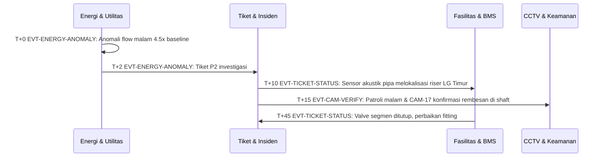

| # | T+ | Dari → Ke | Event | Aktor | Aksi | Data |
|---|---|---|---|---|---|---|
| 1 | T+0 | ENE | `EVT-ENERGY-ANOMALY` | ENM | Anomali flow malam 4.5x baseline | - |
| 2 | T+2 | ENE → TIC | `EVT-ENERGY-ANOMALY` | CCO | Tiket P2 investigasi | ticket |
| 3 | T+10 | TIC → BMS | `EVT-TICKET-STATUS` | MEP | Sensor akustik pipa melokalisasi riser LG Timur | - |
| 4 | T+15 | TIC → CCTV | `EVT-CAM-VERIFY` | QRT | Patroli malam & CAM-17 konfirmasi rembesan di shaft | - |
| 5 | T+45 | BMS → TIC | `EVT-TICKET-STATUS` | MEP | Valve segmen ditutup; perbaikan fitting | - |

**Titik keputusan & eskalasi**

- Bila belum pulih 15 menit → eskalasi GM (L1). 30 menit → Direksi (L2).
- Bila ada korban/risiko jiwa → naikkan ke P1 dan ikuti SOP-SEC terkait.

**Verifikasi penutupan:** Pipa diperbaiki, area kering, tekanan normal.

### UC-13
#### Kerumunan event atrium melebihi kapasitas

- **Trigger:** Kerapatan Atrium Utama 92% saat meet & greet artis
- **Prioritas:** P2 · **Dashboard utama:** CCTV & Keamanan · **Terkait:** TIC, BMS, O360, PARK
- **SOP acuan:** SOP-VIS-01, SOP-COM-04
- **Aktor:** CCO (Operator Command Center (Dispatcher)), CSEC (Chief Security), QRT (Security Quick Response Team), BMSO (Operator BMS), MKT (Marketing & CRM), PKR (Koordinator Parkir)
- **Kriteria sukses:** Kepadatan < 70% <= 20 menit, 0 insiden desak-desakan
- **Tiket:** "Kepadatan Atrium Utama 92% (event meet & greet)" · lokasi GF Atrium Cibadag · sumber AI Crowd Density CAM-01 · kamera CAM-01

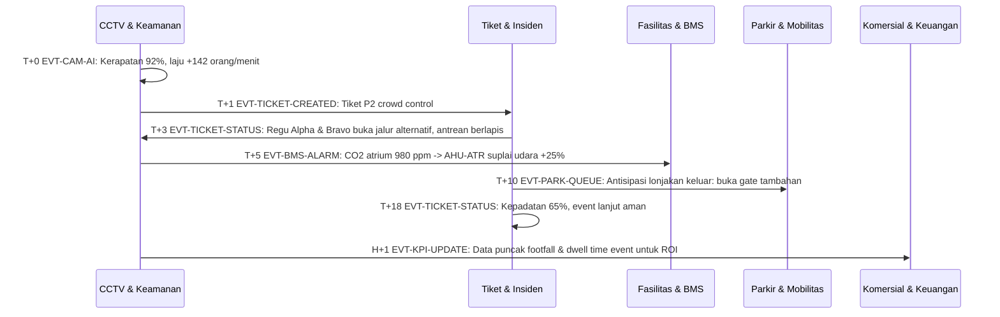

| # | T+ | Dari → Ke | Event | Aktor | Aksi | Data |
|---|---|---|---|---|---|---|
| 1 | T+0 | CCTV | `EVT-CAM-AI` | CCO | Kerapatan 92%, laju +142 orang/menit | - |
| 2 | T+1 | CCTV → TIC | `EVT-TICKET-CREATED` | CCO | Tiket P2 crowd control | ticket |
| 3 | T+3 | TIC → CCTV | `EVT-TICKET-STATUS` | CSEC | Regu Alpha & Bravo buka jalur alternatif, antrean berlapis | - |
| 4 | T+5 | CCTV → BMS | `EVT-BMS-ALARM` | BMSO | CO2 atrium 980 ppm -> AHU-ATR suplai udara +25% | - |
| 5 | T+10 | TIC → PARK | `EVT-PARK-QUEUE` | PKR | Antisipasi lonjakan keluar: buka gate tambahan | - |
| 6 | T+18 | TIC | `EVT-TICKET-STATUS` | CSEC | Kepadatan 65%; event lanjut aman | - |
| 7 | H+1 | CCTV → O360 | `EVT-KPI-UPDATE` | MKT | Data puncak footfall & dwell time event untuk ROI | - |

**Titik keputusan & eskalasi**

- Bila belum pulih 15 menit → eskalasi GM (L1). 30 menit → Direksi (L2).
- Bila ada korban/risiko jiwa → naikkan ke P1 dan ikuti SOP-SEC terkait.

**Verifikasi penutupan:** Kepadatan < 70% selama 15 menit.

### UC-14
#### Predictive maintenance eskalator sebelum akhir pekan

- **Trigger:** Tren getaran E-07 naik ke 2.6 mm/s (batas 2.8) hari Kamis
- **Prioritas:** P3 · **Dashboard utama:** Fasilitas & BMS · **Terkait:** TIC, ANL
- **SOP acuan:** SOP-BMS-06
- **Aktor:** BMSO (Operator BMS), CENG (Chief Engineering), MEP (Teknisi MEP Siaga)
- **Kriteria sukses:** Perbaikan terencana malam Jumat, 0 downtime tak terencana akhir pekan
- **Tiket:** "PM eskalator E-07, getaran naik 2.6 mm/s" · lokasi 1F East E-07 · sumber Vibration IoT ESC-E07

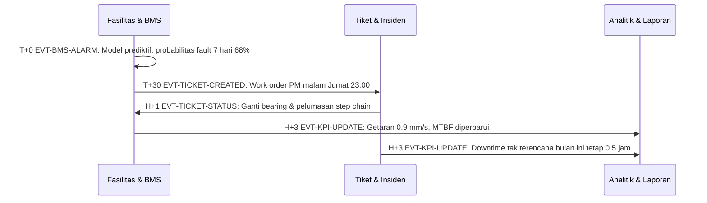

| # | T+ | Dari → Ke | Event | Aktor | Aksi | Data |
|---|---|---|---|---|---|---|
| 1 | T+0 | BMS | `EVT-BMS-ALARM` | BMSO | Model prediktif: probabilitas fault 7 hari 68% | - |
| 2 | T+30 | BMS → TIC | `EVT-TICKET-CREATED` | CENG | Work order PM malam Jumat 23:00 | ticket |
| 3 | H+1 | TIC → BMS | `EVT-TICKET-STATUS` | MEP | Ganti bearing & pelumasan step chain | - |
| 4 | H+3 | BMS → ANL | `EVT-KPI-UPDATE` | CENG | Getaran 0.9 mm/s; MTBF diperbarui | - |
| 5 | H+3 | TIC → ANL | `EVT-KPI-UPDATE` | CENG | Downtime tak terencana bulan ini tetap 0.5 jam | - |

**Titik keputusan & eskalasi**

- Bila belum selesai 60 menit → eskalasi Shift Lead; 2 jam → GM.
- Bila viral di media sosial → langsung eskalasi GM & PR (SOP-VIS-04).

**Verifikasi penutupan:** Parameter kembali di bawah ambang.

### UC-15
#### Anak hilang (Code Adam)

- **Trigger:** Orang tua melapor ke Info Desk GF: anak 6 tahun baju merah
- **Prioritas:** P1 · **Dashboard utama:** Tiket & Insiden · **Terkait:** CCTV, PARK, TEN
- **SOP acuan:** SOP-SEC-09
- **Aktor:** CS (Customer Service / Information Desk), CCO (Operator Command Center (Dispatcher)), CSEC (Chief Security), QRT (Security Quick Response Team), PKR (Koordinator Parkir), TRO (Tenant Relation Officer)
- **Kriteria sukses:** Anak ditemukan <= 15 menit
- **Tiket:** "Code Adam: anak 6 th baju merah" · lokasi 2F Kids Zone (lokasi terakhir) · sumber Info Desk GF · kamera CAM-33

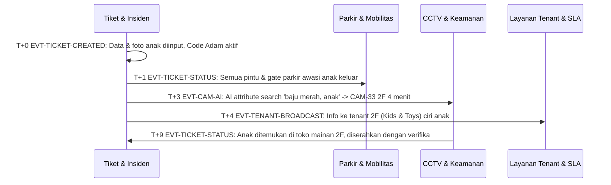

| # | T+ | Dari → Ke | Event | Aktor | Aksi | Data |
|---|---|---|---|---|---|---|
| 1 | T+0 | TIC | `EVT-TICKET-CREATED` | CS | Data & foto anak diinput; Code Adam aktif | ticket |
| 2 | T+1 | TIC → PARK | `EVT-TICKET-STATUS` | PKR | Semua pintu & gate parkir awasi anak keluar | - |
| 3 | T+3 | TIC → CCTV | `EVT-CAM-AI` | CCO | AI attribute search 'baju merah, anak' -> CAM-33 2F 4 menit lalu | - |
| 4 | T+4 | TIC → TEN | `EVT-TENANT-BROADCAST` | TRO | Info ke tenant 2F (Kids & Toys) ciri anak | - |
| 5 | T+9 | CCTV → TIC | `EVT-TICKET-STATUS` | QRT | Anak ditemukan di toko mainan 2F; diserahkan dengan verifikasi | - |

**Titik keputusan & eskalasi**

- Bila verifikasi visual > 60 detik belum selesai → dispatch tetap jalan (asumsikan nyata).
- Eskalasi GM & Owner otomatis detik ke-1; Shift Lead memastikan ACK.
- Bila tidak terkendali dalam 3 menit → panggil pihak eksternal (Damkar 113 / Polisi 110 / Ambulans 118/119).

**Verifikasi penutupan:** Anak diserahkan ke orang tua dengan verifikasi identitas.

### UC-16
#### Laporan BOD bulanan gabungan

- **Trigger:** Akhir bulan / permintaan Direksi
- **Prioritas:** - · **Dashboard utama:** Analitik & Laporan · **Terkait:** O360, TIC, BMS, ENE, TEN, CCTV, PARK
- **SOP acuan:** SOP-FIN-04, SOP-FIN-03
- **Aktor:** FIN (Finance AR & Billing), GM (General Manager Mall), BOD (Direksi / Owner)
- **Kriteria sukses:** Paket laporan BOD terbit <= H+5
- **Tiket:** "Susun laporan BOD bulanan" · lokasi Command Center · sumber Generator Laporan

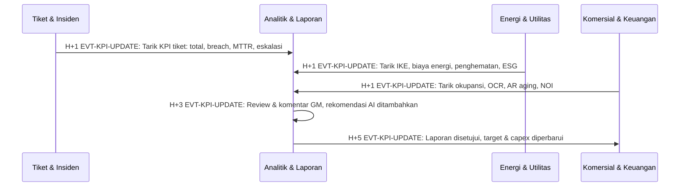

| # | T+ | Dari → Ke | Event | Aktor | Aksi | Data |
|---|---|---|---|---|---|---|
| 1 | H+1 | TIC → ANL | `EVT-KPI-UPDATE` | FIN | Tarik KPI tiket: total, breach, MTTR, eskalasi | - |
| 2 | H+1 | ENE → ANL | `EVT-KPI-UPDATE` | ENM | Tarik IKE, biaya energi, penghematan, ESG | - |
| 3 | H+1 | O360 → ANL | `EVT-KPI-UPDATE` | FIN | Tarik okupansi, OCR, AR aging, NOI | - |
| 4 | H+3 | ANL | `EVT-KPI-UPDATE` | GM | Review & komentar GM; rekomendasi AI ditambahkan | - |
| 5 | H+5 | ANL → O360 | `EVT-KPI-UPDATE` | BOD | Laporan disetujui; target & capex diperbarui | - |

**Titik keputusan & eskalasi**

- Proses bisnis terjadwal: keputusan diambil di rapat mingguan/bulanan sesuai SOP.

**Verifikasi penutupan:** BOD menyetujui laporan.

### UC-17
#### Hari-H acara atrium: indikasi tiket palsu & lonjakan check-in

- **Trigger:** >= 3 pindaian QR tidak valid/duplikat di Gate A dalam 10 menit saat konser Atrium Cibadag
- **Prioritas:** P2 · **Dashboard utama:** Pemantauan Event · **Terkait:** TIC, CCTV, PARK, ANL
- **SOP acuan:** SOP-EVT-03, SOP-EVT-01
- **Aktor:** GTE (Petugas Gate Check-in (Usher)), EO (Event Officer / Panitia Acara), CCO (Operator Command Center (Dispatcher)), QRT (Security Quick Response Team), CSEC (Chief Security), PKR (Koordinator Parkir)
- **Kriteria sukses:** Gate kembali normal <= 30 menit; 0 tiket dipakai dua kali
- **Tiket:** "Indikasi tiket palsu/calo di Gate A Atrium Cibadag" · lokasi Gate A (Lobby Utama) - Atrium Cibadag · sumber Event Check-in (DB-EVT) · kamera CAM-01

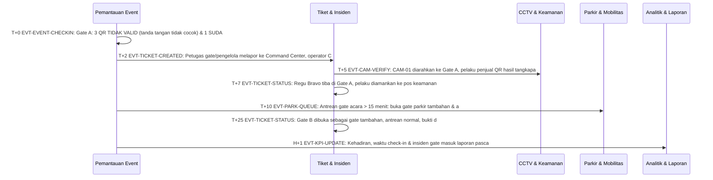

| # | T+ | Dari → Ke | Event | Aktor | Aksi | Data |
|---|---|---|---|---|---|---|
| 1 | T+0 | EVT | `EVT-EVENT-CHECKIN` | GTE | Gate A: 3 QR TIDAK VALID (tanda tangan tidak cocok) & 1 SUDAH DIGUNAKAN dalam 8 menit | gate=A, invalid=3, used=1 |
| 2 | T+2 | EVT → TIC | `EVT-TICKET-CREATED` | CCO | Petugas gate/pengelola melapor ke Command Center; operator CC membuat tiket insiden P2 indikasi tiket palsu/calo dari Pemantauan Event → Gate & Keamanan | ticket |
| 3 | T+5 | TIC → CCTV | `EVT-CAM-VERIFY` | QRT | CAM-01 diarahkan ke Gate A; pelaku penjual QR hasil tangkapan layar teridentifikasi | - |
| 4 | T+7 | TIC | `EVT-TICKET-STATUS` | QRT | Regu Bravo tiba di Gate A, pelaku diamankan ke pos keamanan | - |
| 5 | T+10 | EVT → PARK | `EVT-PARK-QUEUE` | PKR | Antrean gate acara > 15 menit: buka gate parkir tambahan & arahkan drop-off | - |
| 6 | T+25 | TIC | `EVT-TICKET-STATUS` | CSEC | Gate B dibuka sebagai gate tambahan; antrean normal, bukti disimpan | - |
| 7 | H+1 | EVT → ANL | `EVT-KPI-UPDATE` | EO | Kehadiran, waktu check-in & insiden gate masuk laporan pasca-acara | - |

**Titik keputusan & eskalasi**

- Bila belum pulih 15 menit → eskalasi GM (L1). 30 menit → Direksi (L2).
- Bila ada korban/risiko jiwa → naikkan ke P1 dan ikuti SOP-SEC terkait.

**Verifikasi penutupan:** Gate normal 15 menit & pelaku tertangani.

### UC-18
#### Rebutan kursi & pembayaran gagal saat penjualan dibuka

- **Trigger:** Penjualan konser dibuka: dua pembeli memilih kursi VIP yang sama pada detik yang sama; gateway sandbox menolak sebagian pembayaran
- **Prioritas:** P3 · **Dashboard utama:** Pemantauan Event · **Terkait:** TIC, O360, ANL
- **SOP acuan:** SOP-EVT-02, SOP-EVT-04
- **Aktor:** EO (Event Officer / Panitia Acara), IT (IT/OT Engineer), CCO (Operator Command Center (Dispatcher)), FIN (Finance AR & Billing), CS (Customer Service / Information Desk)
- **Kriteria sukses:** 0 kursi terjual ganda; pembeli gagal bayar mendapat kursi kembali atau dikabari via daftar tunggu
- **Tiket:** "Lonjakan transaksi & gagal bayar penjualan konser" · lokasi Portal tiket online · sumber Event Ticketing Engine

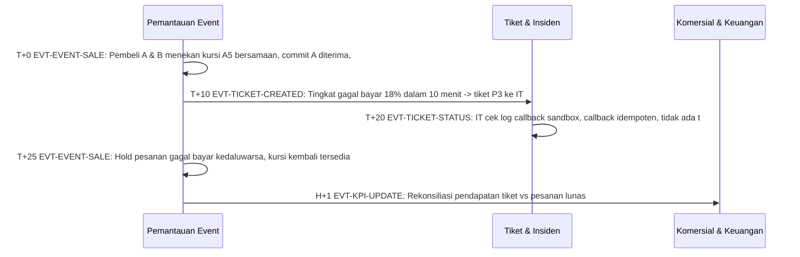

| # | T+ | Dari → Ke | Event | Aktor | Aksi | Data |
|---|---|---|---|---|---|---|
| 1 | T+0 | EVT | `EVT-EVENT-SALE` | EO | Pembeli A & B menekan kursi A5 bersamaan; commit A diterima, commit B ditolak (versi berubah) & B diminta memilih kursi lain | seat=A5, version=v+1 |
| 2 | T+10 | EVT → TIC | `EVT-TICKET-CREATED` | CCO | Tingkat gagal bayar 18% dalam 10 menit -> tiket P3 ke IT | ticket |
| 3 | T+20 | TIC | `EVT-TICKET-STATUS` | IT | IT cek log callback sandbox; callback idempoten, tidak ada tiket terbit ganda | - |
| 4 | T+25 | EVT | `EVT-EVENT-SALE` | EO | Hold pesanan gagal bayar kedaluwarsa, kursi kembali tersedia; daftar tunggu dikabari | - |
| 5 | H+1 | EVT → O360 | `EVT-KPI-UPDATE` | FIN | Rekonsiliasi pendapatan tiket vs pesanan lunas | - |

**Titik keputusan & eskalasi**

- Bila belum selesai 60 menit → eskalasi Shift Lead; 2 jam → GM.
- Bila viral di media sosial → langsung eskalasi GM & PR (SOP-VIS-04).

**Verifikasi penutupan:** Tidak ada pesanan konflik & seluruh keluhan pembeli dijawab.

## 7. Kamus event integrasi

| Event | Nama | Producer | Consumers | Payload | Protokol |
|---|---|---|---|---|---|
| `EVT-BMS-ALARM` | Alarm SCADA/BMS | BMS | TIC, CCTV, TEN, ENE | asset_id, alarm_code, severity, zone, value, threshold, ts | BACnet/Modbus -> MQTT |
| `EVT-FACP-FIRE` | Alarm kebakaran FACP | BMS | TIC, CCTV, TEN, PARK, ANL | detector_id, zone, type(smoke/heat), interlock_state, ts | Dry Contact/BACnet |
| `EVT-CAM-AI` | Deteksi AI video | CCTV | TIC, ANL | cam_id, class(crowd/object/intrusion/fall/fire), confidence, bbox_snapshot, ts | ONVIF/RTSP + Webhook |
| `EVT-CAM-VERIFY` | Verifikasi visual operator | CCTV | TIC | ticket_id, cam_id, verdict(true/false alarm), clip_url | Internal |
| `EVT-TICKET-CREATED` | Tiket dibuat | TIC | TEN, ANL, O360 | ticket_id, priority, category, zone, tenant_id, source, sop_id, sla_due | Internal Bus |
| `EVT-TICKET-STATUS` | Perubahan status tiket | TIC | TEN, ANL | ticket_id, status, team, eta, evidence | Internal Bus |
| `EVT-ESCALATION` | Eskalasi | TIC | O360, ANL | ticket_id, level, recipient, channel, ack_ts | WhatsApp API / Call |
| `EVT-TENANT-MSG` | Pesan / komplain tenant | TEN | TIC | tenant_id, unit, channel, text, category_nlp | WhatsApp Business API / App |
| `EVT-TENANT-BROADCAST` | Broadcast ke tenant | TEN | - | zone, tenants[], template, text | App Push / WhatsApp |
| `EVT-PERMIT` | Izin kerja/overtime disetujui | TEN | BMS, CCTV, ENE | permit_id, tenant_id, type, start, end, zone_ahu | Internal |
| `EVT-ENERGY-ANOMALY` | Anomali energi/air | ENE | BMS, TIC, TEN | meter_id, kind(peak/leak/waste), kw_or_m3, baseline, cost_impact | Modbus/LoRaWAN |
| `EVT-PARK-QUEUE` | Antrean / pelanggaran parkir | PARK | TIC, CCTV | gate_id, queue_len, wait_s, plate, ts | REST / ANPR |
| `EVT-AR-OVERDUE` | Tunggakan tenant | O360 | TEN, BMS | tenant_id, aging_days, amount, sp_level | ISO 20022 / ERP |
| `EVT-KPI-UPDATE` | Pembaruan KPI | Semua | ANL, O360 | kpi_code, value, period, source_dashboard | Data Warehouse |
| `EVT-EVENT-SALE` | Transaksi tiket acara | EVT | ANL, O360, PARK | order_id, event_id, items(type, seat), total, method, status, version, ts | REST/JSON (CAS berversi) |
| `EVT-EVENT-CHECKIN` | Pindaian check-in gate | EVT | TIC, CCTV, ANL | ticket_id, event_id, gate, result(VALID/USED/INVALID), reason, ts | REST/JSON (transaksi atomik) |

## 8. Lampiran: role & kontak

| Kode | Role | Kanal radio |
|---|---|---|
| CCO | Operator Command Center (Dispatcher) | - |
| SL | Shift Lead Ops Command Center | - |
| CSEC | Chief Security | CH-01 |
| QRT | Security Quick Response Team | CH-01 |
| ERT | Emergency Response Team (ERT) | CH-01 |
| CENG | Chief Engineering | CH-02 |
| MEP | Teknisi MEP Siaga | CH-02 |
| BMSO | Operator BMS | CH-02 |
| HK | Supervisor Housekeeping | CH-03 |
| PKR | Koordinator Parkir | CH-04 |
| TRO | Tenant Relation Officer | - |
| CS | Customer Service / Information Desk | - |
| LSG | Leasing Manager | - |
| FIN | Finance AR & Billing | - |
| MKT | Marketing & CRM | - |
| HSE | HSE Officer | - |
| ENM | Energy Manager | - |
| IT | IT/OT Engineer | - |
| PR | Corporate Communication / PR | - |
| GM | General Manager Mall | - |
| BOD | Direksi / Owner | - |
| EO | Event Officer / Panitia Acara | - |
| GTE | Petugas Gate Check-in (Usher) | - |
| EXT | Pihak Eksternal (Damkar/Polisi/PLN/Ambulans) | - |

---
*Ubah konten runbook melalui `tools/docs/sop_data.py` / `tools/docs/usecase_data.py`, lalu jalankan `python3 tools/docs/build_docs.py`.*
